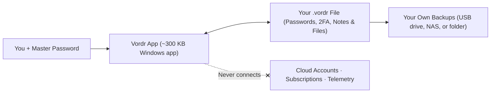
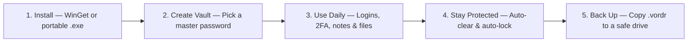

# Vordr

**A quiet, completely offline home for your passwords, two-factor codes, notes, and sensitive files on Windows.**

The name comes from Old Norse *vörðr*—watchman or guardian.

Most password managers ask you to create an online account, pay a recurring subscription, and trust a remote cloud service—along with a huge stack of third-party software—with the keys to your digital life. **Vordr is built for people who want the opposite**: a fast, dependable vault that stays 100% on your own computer, under your own control.



---

## Why people choose Vordr

- **Yours alone, completely offline**: Vordr has no internet connection, no telemetry, no background updater, and no online account. Nothing ever leaves your PC unless you copy or move the encrypted `.vordr` file yourself.
- **One file, zero clutter**: Everything in your vault—logins, two-factor authentication codes, private notes, custom fields, and attached documents or images—lives inside one encrypted `.vordr` file that is easy to back up anywhere.
- **Small, fast, and self-contained**: Written directly for Windows x64 without heavy frameworks, browser engines, or third-party libraries. It starts instantly, sits quietly in your system tray, and uses minimal battery and CPU at rest.
- **Trust you can verify, not just take on faith**: Every part of Vordr is open source, checked by automated safety gates on every build, and reproducible byte-for-byte. Read **[Why Vordr Earns Trust](docs/TRUST.md)** for the full design and verification story.

---

## How everyday use works



### Get started in two minutes

Install with Windows Package Manager (installs for all users on your PC and asks for administrator approval):

```powershell
winget install --id ThomasSmistad.Vordr --exact --source winget
```

Prefer no installer? Download the standalone `vordr.exe` from **[Releases](https://github.com/xxtsxx/Vordr/releases)** and run it from any folder you own ([how to check your download](docs/RELEASES.md#verify-a-download)).

1. **Open Vordr** from the Windows notification area (system tray) and create your vault.
2. **Choose a strong, memorable master password** and store a written copy somewhere physically safe—because Vordr has no server, nobody can reset a forgotten password for you.
3. **Keep an independent backup** of your `.vordr` file (for example on an external drive) and check once that you can unlock the backup copy.

When a new version comes out, updating is always your choice:

```powershell
winget upgrade --id ThomasSmistad.Vordr --exact --source winget
```

See the [update guide](docs/USER_GUIDE.md#updates) for portable copies and managed PCs, and [antivirus guidance](docs/ANTIVIRUS.md) if Windows SmartScreen warns about an unfamiliar download.

---

## What you can do with Vordr

| Everyday need | How Vordr handles it |
|---|---|
| **Logins & custom records** | Store usernames, passwords, website links, notes, custom-labeled fields, favorites, custom icons, field change history, and a Trash view. |
| **Two-factor codes (2FA)** | Built-in TOTP code generator with a live countdown bar, right alongside your login. |
| **Private files & images** | Attach sensitive PDFs, recovery codes, photos, or text files directly inside an entry—encrypted inside the same `.vordr` file. |
| **Strong password generator** | Create random passwords, multi-word passphrases, pronounceable strings, PINs, or hex keys in one click. |
| **Automatic tidy-up** | Clears copied secrets from the clipboard after 20 seconds, locks automatically when you step away or lock Windows, and can prompt for your master password on an isolated Windows desktop. |
| **Optional hardware shortcut** | On PCs with a TPM chip, optionally unlock on that device without retyping your master password every time (with a gentle 30-day reminder so your password stays fresh). |
| **Easy import, export & IT policy** | Share selected entries as a separate `.vordr` file or an encrypted `.zip` archive; organizations can deploy via MSI and lock settings through Windows Registry policy. |

---

## Built for earned trust

Good security tools tell you both **how they protect you** and **what still depends on you**:

- **Strong protection on disk and in memory**: Your vault is locked with modern, memory-hard encryption, checked for tampering every time you open it, and wiped from Vordr's memory as soon as you lock it.
- **Independently checked**: Every release is tested against published cryptographic standards, an independent vault reader that shares no code with Vordr, automated GUI and parser tests, and reproducible builds.
- **Clear real-world expectations**: Keep a strong master password, lock Vordr before hibernating or leaving your PC unattended, remember that anything you copy or open in another app becomes visible to that app, and keep a separate backup of your `.vordr` file.

Explore **[Why Vordr Earns Trust (`docs/TRUST.md`)](docs/TRUST.md)** for why the architecture was designed this way, how every safety layer works, and how to run the verification suite yourself.

---

## Where to go next

| If you want to… | Read |
|---|---|
| Learn everyday features, backups, and import/export | [User guide](docs/USER_GUIDE.md) |
| Understand why Vordr is trustworthy and how it is verified | **[Trust & safety overview](docs/TRUST.md)** · [Visual verification map](docs/assurance.html) |
| Roll out Vordr across company PCs or set policies | [Deployment & policy guide](docs/DEPLOYMENT.md) |
| Dive into architecture, file format, or memory handling | [Architecture](docs/ARCHITECTURE.md) · [File format](docs/formats.md) · [Secret memory](docs/SECRETS.md) |
| Build from source, run the test suite, or verify a release hash | [Development](docs/DEVELOPMENT.md) · [Assurance](docs/ASSURANCE.md) · [Release hashes](docs/RELEASES.md) · [Release checklist](docs/RELEASE_CHECKLIST.md) |
| Browse every document in one list | [Documentation index](docs/README.md) |

## Feedback & security reports

- **Bug reports & questions**: [Open an issue on GitHub](https://github.com/xxtsxx/Vordr/issues) using sample data (never include real passwords or personal screenshots).
- **Security vulnerabilities**: Please report privately through [GitHub Security Advisories](https://github.com/xxtsxx/Vordr/security/advisories/new)—see our [Security policy](SECURITY.md).

## License

Released under the [MIT License](LICENSE.txt).

## AI-assisted development

Vordr is developed using AI. Anthropic Opus 4.8-5.5, Fable 5-5.1, Moonshot Kimi K3, ChatGPT 6 Astra, and Google Gemini 4 Carbon have all contributed to the code, quality, and security—backed by deterministic builds, independent reference verifiers, and automated test gates on every change.
