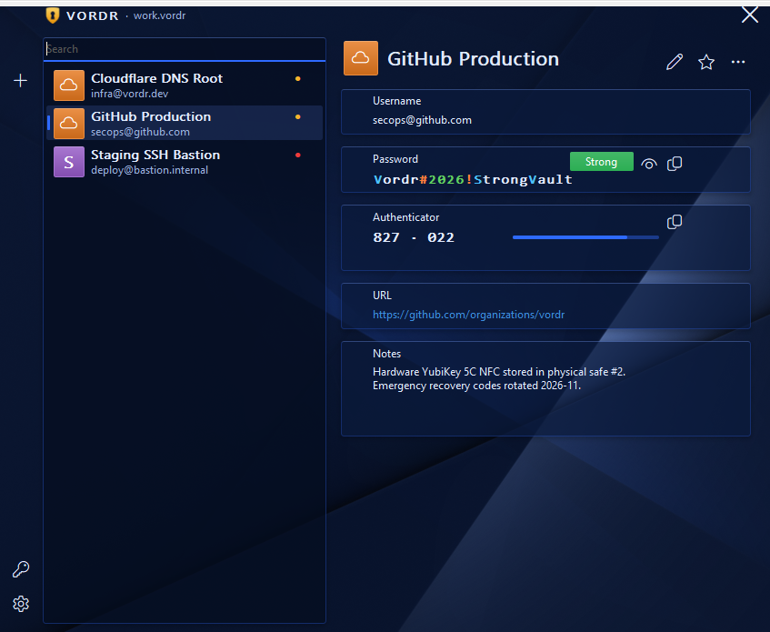
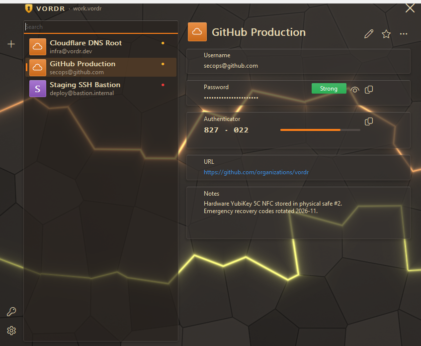
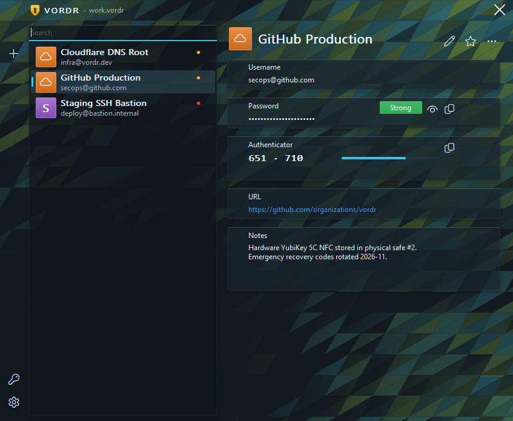
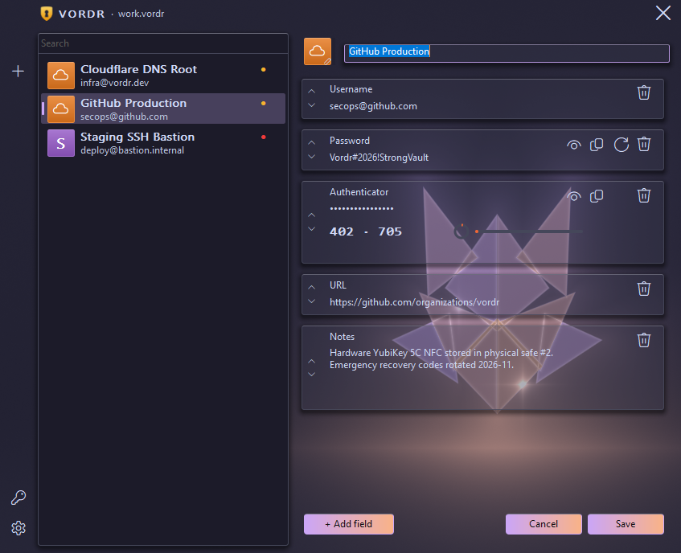
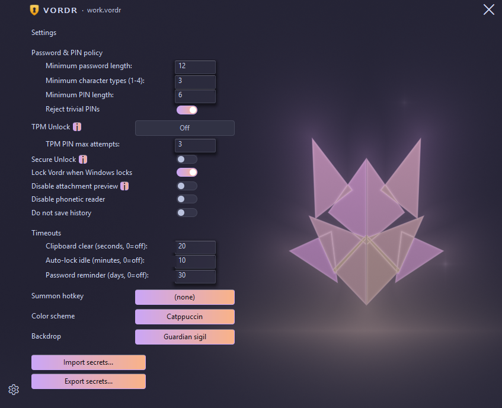

<p align="center">
  
</p>

<h1 id="vordr" align="center">Vordr</h1>

<p align="center">
  Windows x64 &amp; Windows on ARM · Offline-only · Zero third-party libraries · Byte-for-byte reproducible
</p>

<p align="center">
  <a href="#get-started-in-two-minutes">Get started</a> ·
  <a href="#screenshots">Screenshots</a> ·
  <a href="docs/TRUST.md">Why Vordr earns trust</a> ·
  <a href="docs/USER_GUIDE.md">User guide</a> ·
  <a href="docs/DEPLOYMENT.md">Deployment</a>
</p>

---

**A quiet, completely offline home for your passwords, two-factor codes, notes, and sensitive files on Windows.**

The name comes from Old Norse *vörðr*—watchman or guardian.

Most password managers ask you to create an online account, pay a recurring subscription, and trust a remote cloud service—along with a huge stack of third-party software—with the keys to your digital life. **Vordr is built for people who want the opposite**: a fast, dependable vault that stays 100% on your own computer, under your own control.

<br>

<p align="center">
  
</p>

<p align="center">
  <em>Midnight palette with Cut planes backdrop — glass entry cards, syntax-colored passwords, and live two-factor codes (synthetic demo vault).</em>
</p>

<br>

---

## Why people choose Vordr

- **Yours alone, completely offline**: Vordr has no internet connection, no telemetry, no background updater, and no online account. Nothing ever leaves your PC unless you copy or move the encrypted `.vordr` file yourself.
- **One file, zero clutter**: Everything in your vault—logins, two-factor authentication codes, private notes, custom fields, and attached documents or images—lives inside one encrypted `.vordr` file that is easy to back up anywhere.
- **Small, fast, and self-contained**: Written in pure assembly directly for Windows x64 and Windows on ARM ([ARM64 details](docs/ARM64.md)) without heavy frameworks, browser engines, or third-party libraries. It starts instantly, sits quietly in your system tray, and uses minimal battery and CPU at rest.
- **Trust you can verify, not just take on faith**: Every part of Vordr is open source, checked by automated safety gates on every build, and reproducible byte-for-byte. Read **[Why Vordr Earns Trust](docs/TRUST.md)** for the full design and verification story.

---

## Get started in two minutes

Install with Windows Package Manager (installs for all users on your PC and asks for administrator approval):

```powershell
winget install --id ThomasSmistad.Vordr --exact --source winget
```

Prefer no installer? Download the standalone `vordr.exe` (x64) or `vordr-arm64.exe` (Windows on ARM) from **[Releases](https://github.com/xxtsxx/Vordr/releases)** and run it from any folder you own ([how to check your download](docs/RELEASES.md#verify-a-download)). The single universal MSI installer automatically deploys the native binary for your PC.

1. **Open Vordr** from the Windows notification area (system tray) and create your vault.
2. **Choose a strong, memorable master password** and store a written copy somewhere physically safe—because Vordr has no server, nobody can reset a forgotten password for you.
3. **Keep an independent backup** of your `.vordr` file (for example on an external drive) and check once that you can unlock the backup copy.

When a new version comes out, updating is always your choice:

```powershell
winget upgrade --id ThomasSmistad.Vordr --exact --source winget
```

See the [update guide](docs/USER_GUIDE.md#updates) for portable copies and managed PCs, and [antivirus guidance](docs/ANTIVIRUS.md) if Windows SmartScreen warns about an unfamiliar download.

---

## What you can do with Vordr

| Everyday need | How Vordr handles it |
|---|---|
| **Logins, PINs & custom records** | Store usernames, passwords, dedicated PIN codes (checked with PIN-specific length and pattern rules rather than password rules), website links, notes, custom-labeled fields, favorites, custom icons, field change history, Vault Health checks, and a Trash view. |
| **Two-factor codes (2FA)** | Built-in TOTP code generator with a live radial countdown ring, right alongside your login. |
| **Private files & images** | Attach sensitive PDFs, recovery codes, photos, or text files directly inside an entry—encrypted inside the same `.vordr` file. |
| **Strong password & PIN generator** | Create random passwords, multi-word passphrases, pronounceable strings, non-trivial PINs, or hex keys in one click. |
| **Automatic tidy-up** | Clears copied secrets from the clipboard after 20 seconds, hides Vordr windows from ordinary screenshots and screen-sharing by default, locks automatically when you step away or lock Windows, and can prompt for your master password on an isolated Windows desktop. |
| **Configurable hardware shortcut** | On PCs with a TPM chip, keep TPM unlock off, unlock silently on that PC, pair the TPM with a Vordr PIN (which automatically revokes the shortcut after repeated wrong tries), or pair the TPM with Windows Hello (face, fingerprint, or Hello PIN)—with a gentle 30-day reminder so your master password stays fresh. |
| **Clean, adaptable look** | Choose from 14 color palettes (or Follow Windows light/dark mode) and subtle procedural backdrops—or flat surfaces—with flicker-free rendering. |
| **Easy import, export & IT policy** | Share selected entries as a separate `.vordr` file or an encrypted `.zip` archive; organizations can roll out one universal x64/ARM64 MSI and lock settings through Windows Registry policy. |

---

## Screenshots

Choose from **14 color palettes** (plus *Follow Windows* light/dark switching) and **7 procedural backdrops** (plus *Flat*), all rendered cleanly offline without flicker:

| Gruvbox (default) · Low-poly neon | Sapphire · Corner mosaic |
| :---: | :---: |
|  |  |
| **Edit mode · Inline generator & 2FA** | **Settings · Security, TPM & themes** |
|  |  |

---

## Built for earned trust

Good security tools tell you both **how they protect you** and **what still depends on you**:

- **Strong protection on disk and in memory**: Your vault is locked with modern, memory-hard encryption, checked for tampering every time you open it, and wiped from Vordr's memory as soon as you lock it.
- **Independently checked**: Every release is tested against published cryptographic standards, an independent vault reader that shares no code with Vordr, automated GUI and parser tests, and reproducible builds.
- **Clear real-world expectations**: Keep a strong master password, lock Vordr before hibernating or leaving your PC unattended, remember that anything you copy or open in another app becomes visible to that app, and keep a separate backup of your `.vordr` file.

### What about quantum computers?

The `.vordr` vault file itself is well positioned for a post-quantum world: because Vordr is completely offline, there is no public-key network handshake exposed to *"harvest now, decrypt later"* capture, and the vault relies strictly on 256-bit symmetric encryption, 256-bit hashes, and memory-hard password derivation. Shor's algorithm—the quantum breakthrough that threatens RSA and elliptic-curve cryptography—does not apply to symmetric ciphers or hashes, while Grover's algorithm offers at most a theoretical square-root speedup (still leaving 256-bit symmetric keys around 128 bits of effective security, before even counting the severe quantum cost of memory-hard key derivation). Even so, calling the entire application immune to quantum attacks would be inaccurate for two practical reasons: optional **TPM convenience unlock** wraps the local vault key with RSA-2048 inside your PC's TPM chip (hardware binding stops classical key extraction, not a future quantum computer factoring an RSA modulus if an attacker captured both the public key and local wrapped blob), and a weak or short **master password** would be guessed on ordinary hardware long before quantum computing becomes relevant. If you want a strictly symmetric-only, post-quantum posture at rest, leave **TPM Unlock set to Off** and protect your vault with a high-entropy master password or long random passphrase.

Explore **[Why Vordr Earns Trust (`docs/TRUST.md`)](docs/TRUST.md)** for why the architecture was designed this way, how every safety layer works, and how to run the verification suite yourself.

---

## Where to go next

| If you want to… | Read |
|---|---|
| Learn everyday features, backups, and import/export | [User guide](docs/USER_GUIDE.md) |
| Understand why Vordr is trustworthy and how it is verified | **[Trust & safety overview](docs/TRUST.md)** · [Visual verification map](docs/assurance.html) |
| Roll out Vordr across company PCs or set policies | [Deployment & policy guide](docs/DEPLOYMENT.md) |
| Dive into architecture, file format, or memory handling | [Architecture](docs/ARCHITECTURE.md) · [File format](docs/formats.md) · [Secret memory](docs/SECRETS.md) |
| Build from source, run the test suite, or verify a release hash | [Development](docs/DEVELOPMENT.md) · [Assurance](docs/ASSURANCE.md) · [Release hashes](docs/RELEASES.md) · [Release checklist](docs/RELEASE_CHECKLIST.md) |
| Browse every document in one list | [Documentation index](docs/README.md) |

## Feedback & security reports

- **Bug reports & questions**: [Open an issue on GitHub](https://github.com/xxtsxx/Vordr/issues) using sample data (never include real passwords or personal screenshots).
- **Security vulnerabilities**: Please report privately through [GitHub Security Advisories](https://github.com/xxtsxx/Vordr/security/advisories/new)—see our [Security policy](SECURITY.md).

## License

Released under the [MIT License](LICENSE.txt).

## AI-assisted development

Vordr is developed using AI, with the following models contributing to its code, quality, and security—backed by deterministic builds, independent reference verifiers, and automated test gates on every change:

- Anthropic Opus 4.8-5.5
- Fable 5-5.1
- Moonshot Kimi K3
- ChatGPT 6 Astra
- Google Gemini 4 Carbon
- Google Gemini 4 Neon
