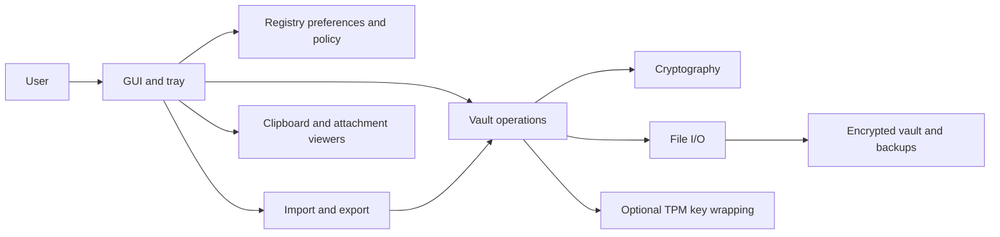
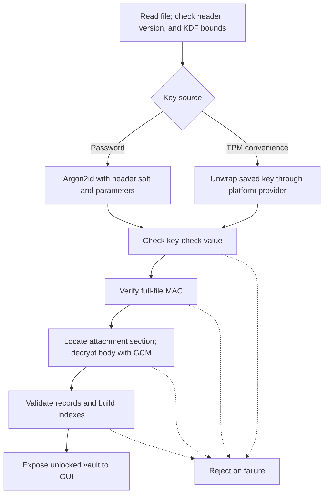
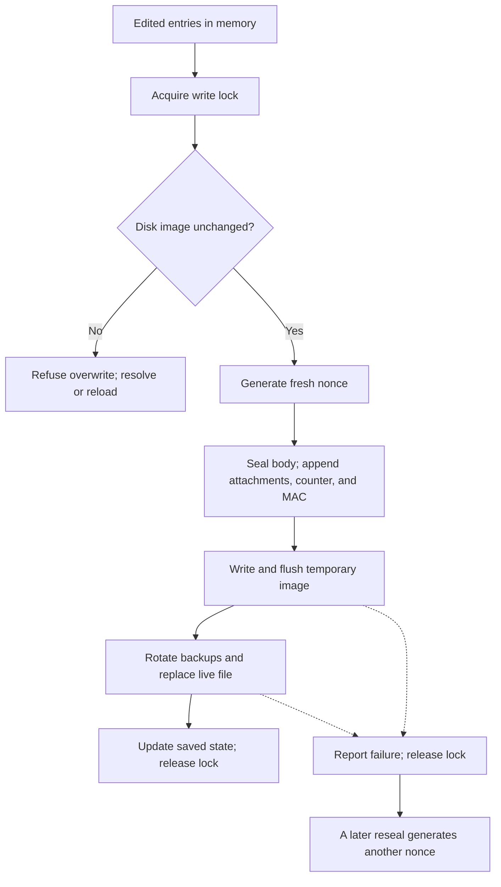

# Architecture

[Documentation](README.md) · [Format reference](formats.md) · [Assurance](ASSURANCE.md)

## System overview

Vordr is structured as a single-binary native Win64 application with zero external
runtime dependencies (`System32` imports only, no CRT, no network client, no auto-updater).
Keeping the entire runtime inside 26 auditable assembly modules eliminates third-party
library supply-chain risk, garbage-collected plaintext copies, and unexpected outbound
connections.

One active vault context exists in memory at a time: `gui.asm` drives user interaction
and desktop/clipboard boundaries, while `vault.asm` owns container authentication,
encryption, and record serialization. Temporary import and export operations park the
active vault snapshot (`vault_state_park` / `vault_state_restore`) and restore the live
key, body, attachment index, and canonical path on every exit path.

The last branch is an exposure boundary: clipboard contents and preview files
are plaintext. Registry settings are outside the vault; TPM blobs and rollback
history are also stored there. The application contains no network client.
Opening a URL or preview launches another application, which may use the network.

## Unlock

The parser must inspect enough unauthenticated header data to choose and bound
the KDF parameters. Bounds checks happen before expensive derivation, but the
allowed maximum can still be costly. Authentication follows key recovery.

The complete 80-byte header is GCM associated data. The mandatory file MAC
covers the encrypted body, attachment section, and save counter. A version-2
file without a valid trailer is rejected; version 1 is not accepted by this reader.

## Save and retry

`vault_reseal` checks read-only state, acquires an advisory `<vault>.lock`,
and checks whether the on-disk file changed since it was loaded. It generates
a new 12-byte random body nonce before calling the writer.

The GUI's edit transaction retains the original body and history until saving
succeeds. A failed save restores the original model while retaining the edit
form for retry. Internal file-write retries operate on the already-constructed
ciphertext; a new reseal draws a new nonce.

Temporary writes and replacement reduce partial-write risk. They cannot promise
durability against every filesystem, storage device, power failure, or sync
conflict. Nearby rotating backups are not an independent backup.

## Cryptographic components

| Purpose | Implementation |
|---|---|
| Password derivation | Argon2id; default t=3, m=524288 KiB, p=1 |
| Vault body and attachments | AES-256-GCM with 96-bit nonces |
| Key-check value | First 16 bytes of SHA-256 of the vault key |
| Full-file authentication | BLAKE2b-256 over a domain prefix, vault key, and file image through the counter |
| TOTP | HMAC-SHA-1, base32 keys, HOTP/TOTP |
| ZIP interoperability | WinZip AE-2: PBKDF2-HMAC-SHA1, AES-256-CTR, truncated HMAC-SHA1, plus per-attachment `SHA-256` plaintext digests inside `vordr.json` |
| Passphrase generation | Unbiased 16-bit draws across an embedded `2,048`-word list (`11` bits/word, `6..24` words) |
| Randomness | `BCryptGenRandom`, supplemented by RDSEED across 8-byte lanes and `1..7`-byte tails when available |
| TPM convenience | Non-exportable RSA-2048 OAEP (SHA-256, `NCRYPT_ALLOW_DECRYPT_FLAG`) wrapping a 64-byte context-bound payload `key32 \|\| SHA-256(key32 \|\| label32)` where `label32 = SHA-256("Vordr-TPM-v2" \|\| vault_salt \|\| LE32(reqhello))` via Microsoft Platform Crypto Provider |

These are in-repository implementations of published primitives, verified at startup by
23 known-answer suites and cross-checked against Python stdlib and published NIST/RFC
vectors (`tests/verify_crypto.py`, `tests/verify_vault.py`). The file MAC uses an
explicit domain-prefixed `BLAKE2b-256` construction rather than BLAKE2's parameter-block
keyed mode; see [the exact format](formats.md#file-authentication-trailer).

TPM key creation requests RSA-2048 (`NCRYPT_OVERWRITE_KEY_FLAG`) restricted to decryption
only (`NCRYPT_ALLOW_DECRYPT_FLAG`, non-exportable), existing persistent keys are checked
via `NCryptGetProperty("Length")` so keys shorter than 2048 bits are rejected, and
unenrollment deletes the persistent provider key via `NCryptDeleteKey`. Because Windows
`PCPKSP.dll` silently ignores `BCRYPT_OAEP_PADDING_INFO.pbLabel` on hardware TPM keys,
Vordr enforces cryptographic vault-and-policy binding inside the sealed plaintext itself:
`tpm_seal` encrypts `key32 || SHA-256(key32 || label32)` (64 bytes) and `tpm_unseal`
verifies the 32-byte binding digest in constant time (`ct_memcmp`) before releasing
`key32`, preventing cross-vault or downgraded-policy blob transplants (`tpmkat`). Legacy
32-byte blobs are accepted only when `TpmRequireHello == 0`. When `TpmRequireHello` is
active, `tpm_seal` fails closed if `NCRYPT_UI_POLICY_PROPERTY` cannot be applied, and
`tpm_unseal` propagates the owner `HWND` without `NCRYPT_SILENT_FLAG` so Windows Hello UI
can prompt cleanly; provider UI enforcement itself depends on the local platform provider.

Random generation fails closed if the OS RNG fails or the output pointer is NULL.
RDSEED is optional, can run out of retries, and mixes into both eight-byte lanes
and `1..7`-byte trailing bytes when available; the OS output remains the primary
random source. Random nonces have a nonzero collision probability. The save
counter is for rollback detection, not nonce generation.

New attachments get independent random keys and nonces. Existing attachment
ciphertext can be copied unchanged into a new image or native export. A pending
attachment is re-encrypted from the same staged bytes; changed content is staged
with fresh encryption metadata.

ZIP password derivation uses 1,000 iterations, substantially less costly than
the native vault KDF. Within an exported archive, `vordr.json` embeds a `"sha256"`
digest for each attachment so `zi_addattach` verifies plaintext integrity in
constant time (`ct_memcmp`), and `zi_stage` fails closed with atomic rollback if
any referenced member is missing or tampered (`zexselkat`). Legacy Vordr `.zip`
exports without `"sha256"` remain readable. ZIP remains an interoperability
trade-off rather than an equivalent backup format; see the
[WinZip specification](https://www.winzip.com/en/support/aes-encryption/).

## Security boundaries

| Boundary | Control | Limit |
|---|---|---|
| Stolen vault file | Password derivation and authenticated encryption | Weak passwords can still be guessed offline |
| Untrusted file contents | Length/cost caps, reparse/ADS/UNC handle validation (`file_validate_handle`), and authentication before record use | Parsers and crypto remain security-critical code |
| Concurrent saves | Advisory lock and changed-image check | Sync clients and non-cooperating writers need not honor the lock |
| Older intact vault | Counter compared with local HKCU history | No trusted global monotonic counter |
| Unlocked process memory | Selected locked buffers, out-of-line `secmem` metadata, IME-detached edit scrubbing, runtime checks | Not all scratch is locked; no hostile-OS guarantee |
| Screen & password entry | Default `SetWindowDisplayAffinity(WDA_EXCLUDEFROMCAPTURE)` (`AllowScreenCapture`) and DACL-protected private desktop (`SecureUnlock`) | Policy-locked `SecureUnlock` refuses fallback; privileged/kernel observation or physical cameras remain possible |
| Convenience unlock | TPM wrapping; non-exportable RSA-2048 minimum + inner context digest; fail-closed provider UI policy setup | An alternative unlock route, not a second factor; runtime UI prompt depends on platform provider |
| Clipboard and previews | Fail-closed exclusion markers, tray-timed clear, safe-preview allowlist, inheritable owner+`SYSTEM` temp ACLs, startup stale-dir sweep | Other applications may copy or retain active plaintext |

Avoid calling the whole application “quantum-proof.” The native vault uses
symmetric cryptography, while the optional TPM path uses RSA. A hardware-bound
private key does not turn RSA into a post-quantum algorithm.

## Runtime hardening

Shared macros provide stack canaries, software shadow-stack checks, guarded
indirect-call landing pads, checked arithmetic, and bounds/type checks. General
heap allocations (`mem_alloc`/`mem_free`) carry header/footer canaries and
allocation magic tags (`tagged_alloc`/`tagged_free`). The import table is made
read-only after startup. Link flags and `loadcfg.asm` enable ASLR, DEP/NX,
high-entropy address space, CET compatibility where supported, and PE
`DependentLoadFlags = 0x0800` (`LOAD_LIBRARY_SEARCH_SYSTEM32`), reinforced at
runtime by `SetDefaultDllDirectories(LOAD_LIBRARY_SEARCH_SYSTEM32)`, safe
search-path mode, and `SetProcessMitigationPolicy` (`ProcessExtensionPointDisablePolicy`,
`ProcessStrictHandleCheckPolicy`, `ProcessImageLoadPolicy`, and
`ProcessDynamicCodePolicy`). Singleton IPC applies an owner+`SYSTEM` DACL plus
Medium-IL `NO_WRITE_UP` SACL on the named mutex and verifies both sender and
receiver `WM_COPYDATA` endpoints against the running `vordr.exe` file identity.

The software shadow stack is per thread: `FRAME_PROLOG` and `FRAME_EPILOG` find
the calling thread's block through a TLS slot (`sstk_thread_init` gives each
thread one, between guard pages), and `FRAME_EPILOG` checks the top-of-stack
slot directly so skipped ancestor frames trap immediately. Threads Windows
creates on Vordr's behalf, OS-dispatched callbacks (`WndProc`, `DialogProc`,
`SubclassProc`, `TimerProc`, `EnumWindowsProc`, exception handlers), and any
code before `hardening_init` use raw stack frames verified by `framecheck.py`.
Worker threads (`secdesk_thread`, the parallel KAT workers) initialise their own
block first and free it last.

These checks detect particular misuse patterns; they do not make assembly
memory-safe. Windows CFG (`/guard:cf`) is deliberately not enabled because the
build lacks the required MASM callback metadata. The software landing-pad guard
must not be described as Windows CFG.

## Source map

| Files under `src/` | Responsibility |
|---|---|
| `main.asm`, `gui.asm` | CPU/startup gates, CLI dispatch, windows, dialogs, tray |
| `macros.inc` | Shared constants, structures, and calling/hardening macros |
| `hardening.asm`, `loadcfg.asm` | Runtime checks, heap, exception handling, PE load configuration |
| `secmem.asm` | Locked secret allocations, tracked frees, selected panic wipes |
| `random.asm` | OS RNG and optional hardware mixing |
| `sha256.asm`, `sha1.asm`, `aesgcm.asm`, `blake2b.asm`, `argon2.asm` | Cryptographic primitives |
| `vault.asm` | Container parsing/writing, records, attachments, native import/export |
| `totp.asm`, `pwgen.asm` | One-time codes, password generation and policy |
| `tpm.asm`, `regcfg.asm` | TPM wrapping, registry precedence, paths, rollback history |
| `zipexport.asm`, `zipimport.asm` | AES ZIP and JSON interoperability |
| `theme.asm` | Color schemes and painting; interaction shades derived per scheme (`col_mix`) |
| `anim.asm` | The animation clock: eased value slots driven by one timer that runs only while something moves, off when Windows' "Animation effects" is |
| `fileio.asm`, `console.asm`, `log.asm` | File access, diagnostic output, logging |
| `selftest.asm`, `redteam.asm`, `bench.asm` | Self-tests, fault injection, benchmarks |

See [settings ownership](SETTINGS_DESIGN.md) and
[system-item indexing](SYSITEM_DESIGN.md) before modifying those paths.
