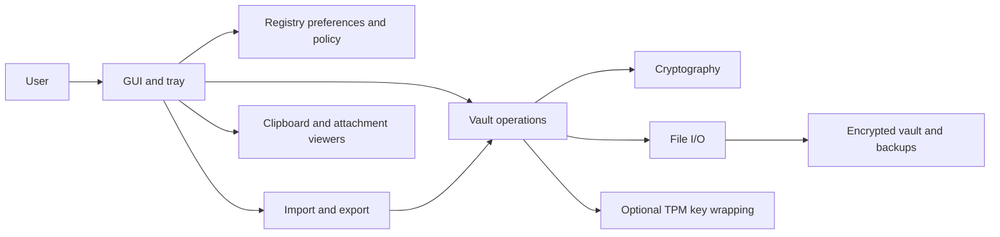
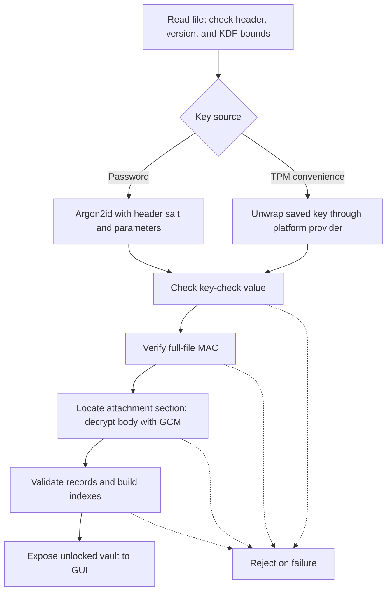
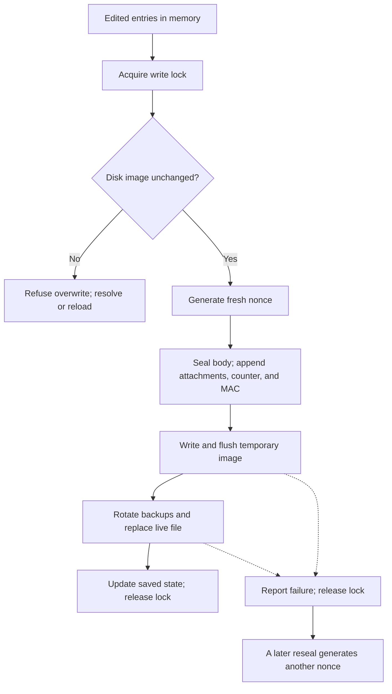

# Architecture

[Documentation](README.md) · [Format reference](formats.md) · [Assurance](ASSURANCE.md)

## System overview

Vordr ships as standalone native assembly executables for both Windows x64 (`vordr.exe`)
and Windows on ARM (`vordr-arm64.exe`, see [ARM64](ARM64.md)) with zero external runtime
dependencies (15 static `System32` import libraries, 4 dynamic `System32` DLLs loaded
exclusively via `LOAD_LIBRARY_SEARCH_SYSTEM32`, no CRT, no network client, no auto-updater).
Keeping the entire runtime inside 27 auditable MASM modules (`src/*.asm`) plus 5
hand-written AArch64 ISA modules (`src/arm64/*.S`) eliminates third-party library
supply-chain risk, garbage-collected plaintext copies, and unexpected outbound connections.

One active vault context exists in memory at a time: `gui.asm` drives user interaction
and desktop/clipboard boundaries, while `vault.asm` owns container authentication,
encryption, and record serialization. Temporary import and export operations park the
active vault snapshot (`vault_state_park` / `vault_state_restore`) and restore the live
key, body, attachment index, and canonical path on every exit path.

The last branch is an exposure boundary: clipboard contents and preview files
are plaintext. Registry settings are outside the vault; TPM blobs and rollback
history are also stored there. The application contains no network client.
Opening a URL or preview launches another application, which may use the network.

## Unlock

The parser must inspect enough unauthenticated header data to choose and bound
the KDF parameters. Bounds checks happen before expensive derivation, but the
allowed maximum can still be costly. Authentication follows key recovery.

The complete 80-byte header is GCM associated data. The mandatory file MAC
covers the encrypted body, attachment section, and save counter. A version-2
file without a valid trailer is rejected; version 1 is not accepted by this reader.

## Save and retry

`vault_reseal` checks read-only state, acquires an advisory `<vault>.lock`,
and checks whether the on-disk file changed since it was loaded. It generates
a new 12-byte random body nonce before calling the writer.

The GUI's edit transaction retains the original body and history until saving
succeeds. A failed save restores the original model while retaining the edit
form for retry. Internal file-write retries operate on the already-constructed
ciphertext; a new reseal draws a new nonce.

Temporary writes and replacement reduce partial-write risk. They cannot promise
durability against every filesystem, storage device, power failure, or sync
conflict. Nearby rotating backups are not an independent backup.

## Cryptographic components

| Purpose | Implementation |
|---|---|
| Password derivation | Argon2id; default t=3, m=524288 KiB, p=1 |
| Vault body and attachments | AES-256-GCM with 96-bit nonces |
| Key-check value | First 16 bytes of SHA-256 of the vault key |
| Full-file authentication | BLAKE2b-256 over a domain prefix, vault key, and file image through the counter |
| TOTP | HMAC-SHA-1, base32 keys, HOTP/TOTP |
| ZIP interoperability | WinZip AE-2: PBKDF2-HMAC-SHA1, AES-256-CTR, truncated HMAC-SHA1, plus per-attachment `SHA-256` plaintext digests inside `vordr.json` |
| Passphrase generation | Unbiased 16-bit draws across an embedded `2,048`-word list (`11` bits/word, `6..24` words) |
| Randomness | `BCryptGenRandom`, supplemented by `RDSEED` (x64) or ARMv8.5 `RNDRRS` (ARM64 when all online cores advertise `FEAT_RNG`) across 8-byte lanes and `1..7`-byte tails |
| TPM convenience (Modes 1–3) | Non-exportable RSA-2048 OAEP (SHA-256, `NCRYPT_ALLOW_DECRYPT_FLAG`) wrapping a 64-byte context-bound payload `secret32 \|\| SHA-256(secret32 \|\| label32)` (`label32 = SHA-256("Vordr-TPM-v2" \|\| vault_salt \|\| LE32(mode))`) in Microsoft Platform Crypto Provider, plus `S0`/`S1` pre-commit state-key rotation + `Argon2id` (`64 MiB`, `t=2`) in `TPM + PIN` (`Mode 2`) and Windows Hello FIDO2 `PRF` (`hmac-secret` via `webauthn.dll`, `WHLO` v1) dual-key wrapping in `TPM + Hello` (`Mode 3`) |

These are in-repository implementations of published primitives (AES-NI/PCLMULQDQ/SHA-NI/SSE2/AVX2
on x64; ARMv8 Cryptography Extensions `AESE`/`AESMC`/`PMULL`/`SHA256*`/`SHA1*` and NEON
on ARM64), verified at startup by 23 known-answer suites and cross-checked against Python
stdlib and published NIST/RFC vectors (`tests/verify_crypto.py`, `tests/verify_vault.py`,
`tests/arm64/test_*.py`). The file MAC uses an explicit domain-prefixed `BLAKE2b-256`
construction rather than BLAKE2's parameter-block keyed mode; see
[the exact format](formats.md#file-authentication-trailer).

TPM key creation requests RSA-2048 (`NCRYPT_OVERWRITE_KEY_FLAG`) restricted to decryption
only (`NCRYPT_ALLOW_DECRYPT_FLAG`, non-exportable), existing persistent keys are checked
via `NCryptGetProperty("Length")` so keys shorter than 2048 bits are rejected, and
unenrollment, revocation, or `vault_tpm_remember` write failure deletes persistent provider
keys (`Vordr-<KCV>`, `-S0`, `-S1`) via `NCryptDeleteKey`. Because Windows `PCPKSP.dll`
silently ignores `BCRYPT_OAEP_PADDING_INFO.pbLabel` on hardware TPM keys, Vordr enforces
cryptographic vault-and-mode binding inside the sealed plaintext itself: `tpm_seal`
encrypts `secret32 || SHA-256(secret32 || label32)` (64 bytes) and `tpm_unseal` verifies
the 32-byte binding digest in constant time (`ct_memcmp`) before releasing `secret32`,
preventing cross-vault or cross-mode blob transplants (`tpmkat`). Legacy raw RSA-OAEP
blobs are accepted only when `TpmUnlockMode == 1`, and stored envelopes must satisfy
`blob_mode >= g_tpm_want`. Under `TPM + PIN` (`Mode 2`), every attempt pre-commits
`fails + 1` and `gen + 1` under a freshly created alternate TPM slot key (`S{slot ^ 1}`)
and deletes `S{slot}` (aborting unlock fail-closed if `NCryptDeleteKey` fails) before
running `Argon2id` or testing the PIN, defeating `HKCU` snapshot replay and revoking TPM
enrollment once `fails >= max_tries`. Under `TPM + Windows Hello` (`Mode 3`), Vordr runs
Windows Hello FIDO2 `PRF` (`hmac-secret`) unsealing via `System32\webauthn.dll` **before**
TPM unsealing, validating `UP|UV` flags and credential ID on both seal and unseal,
scrubbing `pbFirst`, deleting replaced or orphaned platform credentials via
`WebAuthNDeletePlatformCredential`, and combining both 32-byte halves with `BLAKE2b-256`
before opening the AES-256-GCM vault-key envelope.

Random generation fails closed if the OS RNG fails or the output pointer is NULL.
Hardware entropy (`RDSEED` on x64; `RNDRRS` on ARM64) is optional, can run out of retries,
and mixes into both eight-byte lanes and `1..7`-byte trailing bytes when available; the OS
output remains the primary random source. Random nonces have a nonzero collision
probability. The save counter is for rollback detection, not nonce generation.

New attachments get independent random keys and nonces. Existing attachment
ciphertext can be copied unchanged into a new image or native export. A pending
attachment is re-encrypted from the same staged bytes; changed content is staged
with fresh encryption metadata.

ZIP password derivation uses 1,000 iterations, substantially less costly than
the native vault KDF. Within an exported archive, `vordr.json` embeds a `"sha256"`
digest for each attachment so `zi_addattach` verifies plaintext integrity in
constant time (`ct_memcmp`), and `zi_stage` fails closed with atomic rollback if
any referenced member is missing or tampered (`zexselkat`). Legacy Vordr `.zip`
exports without `"sha256"` remain readable. ZIP remains an interoperability
trade-off rather than an equivalent backup format; see the
[WinZip specification](https://www.winzip.com/en/support/aes-encryption/).

## Security boundaries

| Boundary | Control | Limit |
|---|---|---|
| Stolen vault file | Password derivation and authenticated encryption | Weak passwords can still be guessed offline |
| Untrusted file contents | Length/cost caps, reparse/ADS/UNC handle validation (`file_validate_handle`), and authentication before record use | Parsers and crypto remain security-critical code |
| Concurrent saves | Advisory lock and changed-image check | Sync clients and non-cooperating writers need not honor the lock |
| Older intact vault | Counter compared with local HKCU history | No trusted global monotonic counter |
| Unlocked process memory | 85 static `VirtualLock` buffers (`.const`), guard-paged `SRWLOCK`-serialized `secmem` arenas, pinned compositor DIB (`g_comp_bits`), IME-detached edit scrubbing, `_ROINIT` lockdown | Not all scratch is locked; no hostile-OS guarantee |
| Screen & password entry | Default `SetWindowDisplayAffinity(WDA_EXCLUDEFROMCAPTURE)` (`AllowScreenCapture`, `HKLM`-only) and atomically DACL-protected private desktop (`SecureUnlock`, 3-state CAS orphan teardown) | Policy-locked `SecureUnlock` refuses fallback; privileged/kernel observation or physical cameras remain possible |
| Convenience unlock | TPM wrapping; non-exportable RSA-2048 minimum + inner context digest; Mode 2 pre-commit slot rotation; Mode 3 `webauthn.dll` FIDO2 `PRF` (`UP\|UV`) | An alternative unlock route, not a second factor; runtime UI prompt depends on platform provider |
| Clipboard and previews | Fail-closed exclusion markers, `WM_COPY`/`WM_CUT` interception, tray-timed clear, 8-extension allowlist, inheritable owner+`SYSTEM` temp ACLs, handle-only stale sweep rejecting hardlinks/junctions | Other applications may copy or retain active plaintext |

Avoid calling the whole application “quantum-proof.” The native vault uses
symmetric cryptography, while the optional TPM path uses RSA. A hardware-bound
private key does not turn RSA into a post-quantum algorithm.

## Runtime hardening

Shared macros provide stack canaries, software shadow-stack checks, guarded
indirect-call landing pads, checked arithmetic, and bounds/type checks. General
heap allocations (`mem_alloc`/`mem_free`) use `VirtualAlloc` with 32-byte `HEAPBLK`
headers, front/rear canaries, allocation magic tags (`tagged_alloc`/`tagged_free`), and
trailing `PAGE_NOACCESS` guard pages. Dynamic function pointers (`d3d11.dll`,
`webauthn.dll`, `tbs.dll`) and `g_secdesk_proc` are XOR-encoded with hardware-seeded
`g_ptr_cookie`. After startup, `iat_lockdown` seals both the PE import table and the
4 KiB-isolated `_ROINIT` section (`g_stack_canary`, `g_ptr_cookie`, `g_sstk_tls`,
`g_cpu_features`, `g_img_lo`, `g_img_hi`) as `PAGE_READONLY`.

Link flags and `loadcfg.asm` (`src/arm64/loadcfg.S` on ARM64) enable ASLR, DEP/NX,
high-entropy address space, CET compatibility on x64 (`/CETCOMPAT`; ARM64 uses
`PACIBSP`/`AUTIBSP` pointer authentication and `BRK #0xF003` fast-fail), and PE
`DependentLoadFlags = 0x0800` (`LOAD_LIBRARY_SEARCH_SYSTEM32`), reinforced at runtime
by `HeapSetInformation(HeapEnableTerminationOnCorruption)`,
`SetDefaultDllDirectories(LOAD_LIBRARY_SEARCH_SYSTEM32)`,
`SetProcessMitigationPolicy` (`ProcessExtensionPointDisablePolicy` and
`ProcessImageLoadPolicy` with `NoRemoteImages | NoLowMandatoryLabelImages | PreferSystem32Images`),
and `WerSetFlags(0x000001E1)` + `WerAddExcludedApplication`.

Legacy `WM_COPYDATA` messages are unconditionally rejected. Single-instance hand-off
uses a per-SID duplex named pipe (`\\.\pipe\VordrIPC-<16hex>`, `PIPE_REJECT_REMOTE_CLIENTS`,
protected owner+`SYSTEM` DACL + Medium-IL `NO_WRITE_UP` SACL) with mutual
`GetNamedPipeClientProcessId`/`GetNamedPipeServerProcessId` + `gui_pid_is_self`
file-identity verification, bounded 250 ms overlapped I/O, a 1-byte server liveness
ACK/NACK (`0x06`/`0x15`) closing PID-reuse races, and a bounded drain loop before
`DisconnectNamedPipe`.

The software shadow stack is per thread (`4,096` entries on both x64 and ARM64):
`FRAME_PROLOG` and `FRAME_EPILOG` find the calling thread's block through an inline
TEB TLS slot (`sstk_thread_init` gives each thread one, between `PAGE_NOACCESS` guard
pages), and `FRAME_EPILOG` checks the top-of-stack slot directly so skipped ancestor
frames trap immediately. Threads Windows creates on Vordr's behalf, OS-dispatched
callbacks (`WndProc`, `DialogProc`, `SubclassProc`, `TimerProc`, `EnumWindowsProc`,
exception handlers), and any code before `hardening_init` use raw stack frames verified
by `framecheck.py` (and enter through 45 generated ABI thunks on ARM64). Worker threads
(`secdesk_thread`, the parallel KAT workers) initialise their own block first and free it
last. Cross-thread Secure Desktop teardown uses per-invocation `g_sd_slots`, a 3-state
atomic CAS (`0`/`1`/`2`), 200 ms `SECDESK_POLL_TIMER` cancellation, and `lfence`
(translating to ARM64 `dmb ish`) acquire barriers on every `g_secdesk_orphans == 0`
consumer path.

These checks detect particular misuse patterns; they do not make assembly
memory-safe. Windows CFG (`/guard:cf`) is deliberately not enabled because the
build lacks the required MASM callback metadata. The software landing-pad guard
must not be described as Windows CFG.

## Source map

| Files under `src/` and `tools/a64/` | Responsibility |
|---|---|
| `main.asm`, `gui.asm` | CPU/startup gates, CLI dispatch, windows, dialogs, full-window off-screen compositor (`gui_present_composite`), named-pipe IPC, Secure Desktop, tray |
| `macros.inc` | Shared constants, structures, and calling/hardening macros |
| `hardening.asm`, `loadcfg.asm` | Runtime checks, `_ROINIT`, guard-paged heap, exception/WER handling, PE load configuration |
| `secmem.asm` | 85-entry `.const` `sec_regions`, `VirtualLock` arenas with `PAGE_NOACCESS` guards and `SRWLOCK` registry, panic wipes (including `g_comp_bits`) |
| `random.asm` | OS RNG (`BCryptGenRandom`) and optional `RDSEED` mixing |
| `sha256.asm`, `sha1.asm`, `aesgcm.asm`, `blake2b.asm`, `argon2.asm` | x64 cryptographic primitives (AES-NI, PCLMULQDQ, SHA-NI, SSE2/AVX2) |
| `vault.asm` | Container parsing/writing, records, attachments, native import/export, `VF_SYSTEM` scoping |
| `totp.asm`, `pwgen.asm` | One-time codes, password/PIN generation, grading, and policy |
| `tpm.asm`, `regcfg.asm` | TPM 2.0 PCP & `webauthn.dll` Hello wrapping, TBS cooldown diagnostics, registry precedence, paths, rollback history |
| `zipexport.asm`, `zipimport.asm` | WinZip AE-2 and JSON interoperability with per-attachment `SHA-256` verification |
| `theme.asm` | 14 color schemes + Follow Windows, perceived-luminance contrast, SSE2 SDF rounded rects, glass cards & sidebar, drop shadows, pill toggles, TOTP countdown bar |
| `anim.asm` | Animation clock: eased value slots driven by one timer while active, honoring Windows' "Animation effects" setting |
| `gpu.asm`, `gpu_backdrops.inc` | Direct3D 11 DirectCompute (`cs_5_0`) procedural backdrops (7 styles via `d3d11.dll` with WARP fallback + SSE2 360° Rodrigues hue cycling, plus flat mode) cached in a 32-bit DIB |
| `fileio.asm`, `console.asm`, `log.asm` | Hardened file access (`file_path_allowed` / `file_validate_handle`), diagnostic output, logging |
| `selftest.asm`, `redteam.asm`, `bench.asm` | 23 startup KAT suites, `katreport`, `dbg`-only fault injection, benchmarks |
| `src/arm64/*.S`, `src/arm64/frame.inc`, `tools/a64/xlat.py` | Hand-written ARMv8 Crypto/NEON/RNG/CPU-gate/load-config modules (`aesgcm.S`, `sha.S`, `blake2b_argon2.S`, `platform.S`, `loadcfg.S`) and deterministic COFF-to-AArch64 translator for the remaining 24 modules ([ARM64.md](ARM64.md)) |

See [settings ownership](SETTINGS_DESIGN.md) and
[system-item indexing](SYSITEM_DESIGN.md) before modifying those paths.
