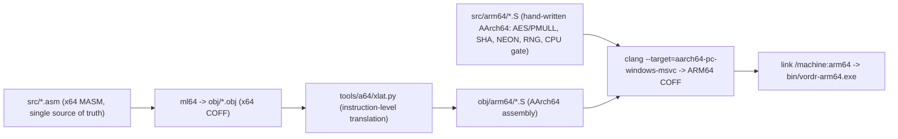

# Vordr on Windows on ARM (ARM64)

[Documentation](README.md) · [Architecture](ARCHITECTURE.md) · [Deployment](DEPLOYMENT.md)

Vordr ships a native ARM64 executable, `vordr-arm64.exe`, built from the same
sources as the x64 `vordr.exe`. Both are pure assembly with no C runtime. The
universal MSI carries both and installs the one that matches the machine.

## How the ARM64 binary is built



- **One logic source.** Application logic (GUI, vault format, parsers, TPM,
  policy) is written once in x64 MASM. `tools/a64/xlat.py` reads the assembled,
  fully macro-expanded x64 objects - instructions, relocations, symbols and
  source line numbers - and emits equivalent AArch64 assembly, annotated with
  the original source line for every translated instruction. A change to the x64
  source therefore reaches the ARM64 build automatically; the two can never
  drift apart.
- **Hand-written where the ISA matters.** Code built on x86-only instructions
  is replaced by hand-written AArch64 in `src/arm64/`:
  AES-256-GCM on the ARMv8 Cryptography Extensions (`AESE`/`AESMC`, `PMULL`
  GHASH), SHA-256 and SHA-1 on the ARMv8 SHA instructions, BLAKE2b and the
  Argon2 compression function on NEON, the CSPRNG mix (`BCryptGenRandom` plus
  `RNDRRS` where the CPU has `FEAT_RNG`), the CPU feature gate, fail-fast and the
  crash handler's view of the ARM64 `CONTEXT`.
- **Same mitigations, ARM64 flavour.** Every framed procedure keeps its stack
  canary and software shadow-stack entry, and additionally signs its return
  address with pointer authentication (`PACIBSP`/`AUTIBSP`; a no-op on CPUs
  without `FEAT_PAuth`). `__fastfail` is `BRK #0xF003`. ASLR, high-entropy VA,
  DEP, the `System32`-only dependent-load flag and the read-only `_ROINIT`
  section are the same as on x64. Intel CET has no ARM64 equivalent and is x64-only.

## Internal calling convention

Translated code keeps x64 register semantics on fixed ARM64 registers, so a
hand-written AArch64 routine that replaces an x64 routine must follow this table.

| x64 | ARM64 | x64 | ARM64 |
|---|---|---|---|
| `rax` | `x8` | `rbx` | `x19` |
| `rcx` | `x0` | `rsi` | `x20` |
| `rdx` | `x1` | `rdi` | `x21` |
| `r8` | `x2` | `r12`..`r15` | `x22`..`x25` |
| `r9` | `x3` | `rbp` | `x29` |
| `r10` | `x9` | `rsp` | `sp` |
| `r11` | `x10` | `xmm0`..`xmm5` | `v0`..`v5` |
| `xmm14`, `xmm15` | `v6`, `v7` | `xmm6`..`xmm13` | `v8`..`v15` |

- Arguments 1-4 arrive in `x0`-`x3`; argument *n* >= 5 is at
  `[sp + 32 + 8*(n-5)]` (the caller's 32-byte home area at `[sp, sp+32)` belongs
  to the callee). The result is returned in `x8` (`rax`).
- A callee preserves `x19`-`x29`, `sp` and the full 128 bits of `v8`-`v15`;
  it may clobber `x0`-`x17` (never `x18`, the TEB pointer), `v0`-`v7`,
  `v16`-`v31` and the flags. `x11`-`x17` and `v16`-`v31` are translator scratch.
- Frames keep the x64 layout: `stp x29, x30, [sp, #-16]!` puts the saved frame
  pointer at `[x29]` and the return address at `[x29+8]`, exactly where x64 keeps
  `rbp` and the return address, so canary and shadow-stack checks are unchanged.
- Calls into Windows use the ARM64 ABI: the call site loads `x4`-`x7` from the
  x64 stack-argument slots, moves arguments 9 and up to `[sp]`, and copies the
  result from `x0` to `x8`. Windows callbacks into Vordr (window procedures,
  subclass procedures, thread procedures, the exception handler) enter through
  a small thunk that does the reverse.

## Building and verification

Requires the same MSVC tools as x64 (`ml64`, `link`, `rc`), Python 3, plus
LLVM (`clang` and `llvm-lib`) on `PATH` or under `C:\Program Files\LLVM\bin`.

```bat
build_arm64.cmd release
```

This outputs a normalised, reproducible `bin\vordr-arm64.exe` (`Machine 0xAA64`)
and records its SHA-256 alongside `vordr.exe` in `bin\SHA256SUMS.txt`.
`tools\verify_repro.ps1` verifies two clean builds of both `vordr.exe` and
`vordr-arm64.exe` are byte-identical.

Every hand-written ARM64 crypto module and the fully linked ARM64 binary are
verified via Unicorn (`UC_CPU_ARM64_MAX`) emulation:

- `tests\arm64\test_sha.py` — SHA-256 / SHA-1 KATs, ABI preservation, and constant-time traces.
- `tests\arm64\test_blake2b_argon2.py` — BLAKE2b / Argon2id RFC 9106 KATs, aliasing, and stack/vector scrub.
- `tests\arm64\test_aesgcm.py` — AES-256-GCM / ECB / CTR KATs, GHASH boundary checks, and vector scrub.
- `tests\arm64\test_arm64_e2e.py` — full PE execution from `wstart` to `ExitProcess` covering release `selftest` (with and without `FEAT_RNG`), fail-closed `cpu_gate`, x64-identical `katreport`, all probeio KATs and fuzzers, and cross-architecture `.vordr` vault interoperability with `tests\verify_vault.py` and frozen x64 fixtures.

## Universal MSI deployment

`tools\make_msi.ps1` packages both `bin\vordr.exe` (`0x8664`) and
`bin\vordr-arm64.exe` (`0xAA64`) inside one universal MSI (`bin\vordr-<ver>.msi`)
with zero custom actions. `AppSearch` + `RegLocator` (`SigHostArch`, `Type = 18`)
reads `HKLM\SYSTEM\CurrentControlSet\Control\Session Manager\Environment\PROCESSOR_ARCHITECTURE`
into `HOST_NATIVE_ARCH` (listed in `SecureCustomProperties`). Two mutually exclusive
64-bit components (`VordrExe` and `VordrExeArm64`) install the host's native binary
to `%ProgramFiles%\Vordr\vordr.exe` alongside its Start Menu shortcut.
`tools\verify_msi.ps1` verifies costing for both `AMD64` and `ARM64` hosts and
checks both embedded PE payloads in `vordr.cab`.
