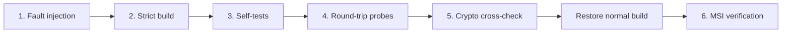

# Assurance and verification

[Documentation](README.md) · [Trust overview](TRUST.md) · [Visual guide](assurance.html) · [Secret memory](SECRETS.md)

This reference maps Vordr's security and reliability claims directly to automated
verifiers, static analyzers, ARM64 emulation suites, and runtime probes—and states
the exact boundary of what each check proves. Every tool below runs offline with the
Windows x64 MSVC/SDK toolchain, LLVM (for ARM64), and Python 3 (stdlib for x64 gates;
Unicorn for ARM64 emulation). No independent external third-party audit is recorded in
this repository.

## Reproduce the checks

Use Windows with the x64 MSVC/SDK toolchain and Python 3 on PATH. Read the
[test-safety warning](DEVELOPMENT.md#full-test-gate-read-before-running) first:
the full driver stops running Vordr processes and replaces build outputs.

```bat
tests\run_all.cmd
```

For crypto checks against an existing executable:

```bat
python tests\verify_crypto.py --exe bin\vordr.exe
```

For the vault format and compatibility (a `probeio` or `dbg` build), the
external GUI tests, and proof that a release reproduces:

```bat
python tests\verify_vault.py bin\vordr.exe
python tests\compattest.py bin\vordr.exe
powershell -NoProfile -ExecutionPolicy Bypass -File tests\guitest.ps1
powershell -NoProfile -ExecutionPolicy Bypass -File tools\verify_repro.ps1
```

Record the commit, toolchain, command, exit status, and complete logs. Do not copy
an old count of passing tests into a claim about a new revision.

## The six-stage gate



| Stage | Evidence produced | Important limit |
|---|---|---|
| Fault injection | 13 deliberate hardening cases (19 assertions in `tests/redteam.py`): stack canary, TLS shadow-stack (top and ancestor-skip), indirect-call landing pad, arithmetic overflow, bounds, type/heap magic, guard-paged heap-tag (`mem_alloc`/`mem_free`), crash-reentrancy, `System32`-only DLL load (`dllhijack`), and read-only IAT violations each trigger their expected exit code or containment (`0xC0000409`, no crash dialog, 120-byte breadcrumb) | Checks termination behavior, not all paths; the IAT case shows the slot is read-only at the write, not that `iat_lockdown` alone made it so |
| Strict build | Ten Python assembly/ABI/resource/doc analyzers (9 guarded against silent coverage loss by `tools/floors.py`) plus assembly/link success and PE validation (`pe_normalise.py`: `LOAD_CONFIG.DependentLoadFlags == 0x0800`, 4 KiB-isolated `_ROINIT`, `W^X`, `/CETCOMPAT` bit); `build.cmd strict` fails closed if Python is absent | Pattern-based static analyzers inspect source idioms rather than proving full program semantics |
| Self-tests | 23 startup known-answer suites pass (also run fail-closed on every normal launch); release binary refuses diagnostic file-writing verbs in the next stage | Fixed vectors verify selected inputs and boundary cases |
| Round-trip | 42 `probeio` probes covering serialization, imports/exports, attachments, policy, TPM label binding & anti-replay, PIN grading, GPU backdrops (`gpukat`), SecureUnlock fail-closed policy, locking, parsers (`vfuzz` 100k, `fuzzzip` 100k, `jfuzz` 20k, `attfuzz` 4k), preview cleanup, and persistence; an independent reader of the vault format (`verify_vault.py`); frozen v0.2.3 vaults (`compattest.py`); and 128+ (up to 152) isolated Win32 GUI checks (`guitest.ps1`) | Synthetic and bounded input space; geometry and GUI tests skip without a desktop |
| Crypto differential | 60 `katreport` lines cross-checked against 58 independent Python recomputations and 25 published FIPS/NIST/RFC vectors (`tests/verify_crypto.py`) | Functional output checks, not a side-channel proof |
| Installer | Builds `bin\vordr-arm64.exe` and the universal x64+ARM64 MSI (`make_msi.ps1` with `Assert-ReleasePe` validation), then verifies MSI tables, 16 policy rows, live `LaunchConditions` numeric/coercion guards, 5-column `MsiLockPermissionsEx` via `msi.dll`'s runtime SQL query, downgrade prevention (`NEWERVERSIONDETECTED`), embedded x64/ARM64 payloads, and dual-arch component costing (`verify_msi.ps1`) | Does not perform a live OS install, upgrade, or uninstall |

`--quick` skips fault injection. `build.cmd release strict` requires Python and
fails closed when Python is missing; missing `makecab` or `clang`/LLVM can skip the installer
stage in `run_all.cmd`. A release review must explicitly inspect any skipped stage.

## Cryptographic checks

`katreport` emits deterministic outputs for public inputs. The verifier uses
Python's `hashlib`, `hmac`, and base32 support, plus an in-file AES-GCM
reference that first checks itself against a fixed GCM vector.

| Primitive | Independent comparison or vector source |
|---|---|
| SHA-256 | Python hashlib; published “abc” digest and block-boundary inputs |
| BLAKE2b | Python hashlib; RFC 7693 digest, block-boundary inputs, and `blake2b_long` (> 64 B) variable-length outputs |
| HMAC-SHA1 | Python hmac; RFC 2202 cases |
| AES-256-GCM & AES-128/192/256 ECB/CTR | In-file Python implementation; FIPS-197 Appendix A.1/A.2/A.3, SP 800-38A/WinZip LE-CTR, fixed GCM vectors, AAD, partial/empty plaintext, and SP 800-38D length bounds |
| Argon2id | RFC 9106 §5.3 vector, parameter-validation bounds, and the reference implementation's `test.c` vector (t=2, 64 MiB, p=1), which - unlike the RFC's two-block segments - regenerates the address block past 128 blocks as every real vault does |
| HOTP/TOTP | HMAC-based recomputation; RFC 4226 HOTP values, RFC 6238 Appendix B 8-digit 64-byte SHA-1 vectors, and time-step inputs |
| Base32 | Python base64 implementation, including 64-byte decoded secrets |

`tests/verify_vault.py` carries a second, independent Argon2id, written from
RFC 9106 and checked against the RFC's vector before it is trusted. It decrypts
real vault files - header, KCV, body, every attachment, the file MAC - using only
`docs/formats.md`, the Python standard library and the self-checked pure-Python
AES-GCM of `verify_crypto.py` (no third-party package), including a vault whose KDF
segments are 2048 blocks long. A writer and reader that share a mistake agree
with each other; this reader shares nothing, so a drift between Vordr and its
published format fails here whichever side moved. The same test flips a byte in
every region of the file and requires both Vordr (`vopen`) and the independent
reader to refuse it, and checks that each save uses a fresh body nonce under the
unchanged key.

A correct output on these inputs does not establish general correctness or
constant-time behavior. `cttest` is a debug timing probe, not a gate-level
side-channel guarantee. For negative controls, use a disposable checkout to
alter an expected result and confirm the verifier reports a mismatch; it does
not expose a command-line option for reading an edited report file.

## Static checks

| Checker under `tools/` | Detects |
|---|---|
| `framecheck.py` | Stack/frame and call-argument layout problems (including nested-call outgoing stack-argument shadow space), mismatched raw epilogues, and OS-dispatched callbacks (`WndProc`, `DialogProc`, `SubclassProc`, `TimerProc`, `EnumWindowsProc`, exception handlers) that improperly use `FRAME_PROLOG` |
| `nvcheck.py` | A procedure that writes a callee-saved register (rbx, rsi, rdi, r12-r15, xmm6-15) without saving and restoring it, or writes `ymm` registers without `vzeroupper` before returning |
| `idcheck.py` | Resource/assembly control-ID drift and collisions |
| `constcheck.py` | Inconsistent constants between modules |
| `dlgtarget.py` | Controls addressed through the wrong known dialog, including settings-table ownership |
| `deadcode.py` | Apparently unreferenced symbols |
| `rccheck.py` | Resource-template geometry problems |
| `wstrcheck.py` | Bounded string-copy calls missing their `r8`/`r8d` bound across the full preceding instruction window, or direct `g_cfg_in` assignments bypassing `cfg_in_set` |
| `aligncheck.py` | Misaligned wide-string declarations (sizes written as names or expressions are resolved, not guessed) |
| `check_docs.py` | Broken relative links/anchors, duplicate heading slugs, unclosed fences, and control characters in documentation |
| `pe_normalise.py` | Release PE hardening (`PE32+`, non-stripped relocations, `BASERELOC`, read-only `IAT`/`LOAD_CONFIG` with `DependentLoadFlags == 0x0800`, `.pdata`, 4 KiB-isolated `_ROINIT`, `W^X`, `/CETCOMPAT` bit) and zeroing COFF/export/load-config/debug timestamps |

These are source-pattern checks, not a complete compiler or program proof.
A refactor can reduce what a checker recognizes without introducing a reported
failure. Inspect coverage and unknown cases when changing the patterns it scans.

## Regression map

The executable commands and their arguments are defined by
[the test driver](../tests/run_all.cmd); some intentionally return a count
rather than the conventional zero-on-success result.

| Area | Relevant probes |
|---|---|
| Secret cleanup and allocation | `secscan`, `secfreedup`, `lktest`, `tmptest` |
| Input parsing and bounds | `vfuzz`, `fuzzzip`, `jfuzz`, `attfuzz`, `attovfkat`, `kdfparam`, `convcap` |
| Save integrity and concurrency | `bktest`, `mactest`, `rbtest`, `xctest`, `reload`, `cowrite` |
| Native exchange and metadata | `sysitemkat`, `vexselkat`, `c9kat`, `vimpkat`, `vattcolkat`, `vaultexportkat`, `vaultexpattkat` |
| ZIP export and attachment binding | `atgen`, `zitest`, `zexcap`, `zexname`, `zexselkat` (selective export filter, `SHA-256` attachment swap rejection, and missing-member atomic rollback) |
| Policy, PIN grading, TPM, and private desktop | `polkat` (`HKLM` fail-closed types, `HKLM`-only `AllowUncVault`, `ProfileList` path expansion, PIN/TPM mode clamping), `pinkat` (PIN scalar length, no-class rule, trivial patterns), `healthkat` (`VF_SECRET` + `VF_PIN` grading and domain-separated reuse), `tpmkat` (OAEP v2 context binding, `S0`/`S1` pre-commit anti-replay, 3-strike revocation), `secdeskkat` |
| GUI geometry, backdrops & failed-edit retry | `layoutkat` (with `savefail` and `guardkat` across 17 guard cases in the same window), `gpukat` (DirectCompute / WARP backdrop dispatch & SSE2 color cycling) |
| GUI behaviour from outside | `tests/guitest.ps1` (128+ checks; 141–152 runtime checks on an interactive desktop): input limits, drawn scrollbars, 9 theme palettes, 17 backdrop modes (16 GPU + Flat), modal dismissal on lock, legacy `WM_COPYDATA` rejection (second-instance hand-off uses a kernel-authenticated per-SID duplex named pipe), default `GetWindowDisplayAffinity` (`0x11`) screen-capture protection, tray clipboard auto-clear, post-lock secret wipes, GDI leaks |
| Vault format, tamper and nonce reuse | `tests/verify_vault.py` |
| Opening vaults written by a release | `tests/compattest.py` (frozen `tests/fixtures/v023-*.vordr`) |
| Long-path context restoration | `tests/verify_persistence.py` (6 short/long-path & preview-cleanup cases) |
| ARM64 crypto & 8-stage E2E emulation | `tests/arm64/test_sha.py`, `test_blake2b_argon2.py`, `test_aesgcm.py`, `test_arm64_e2e.py` (Unicorn ARM64 unit KATs, constant-time SHA traces, release `selftest` with `FEAT_RNG=0/1`, fail-closed `cpu_gate`, x64-identical 60-line `katreport`, 22 probeio KATs/fuzzers, and cross-arch `.vordr` vault interoperability) |
| Dual-arch reproducibility | `tools/verify_repro.ps1` (proves clean builds of both `vordr.exe` and `vordr-arm64.exe` reproduce bit-for-bit and match `bin/SHA256SUMS.txt`) |

`secscan` checks its planted sentinel after a selected wipe path. It does not
inventory every possible plaintext copy, prove pagefile/hibernation exclusion,
or guarantee cleanup after arbitrary process termination.

The secure allocator tracks currently live base addresses. This prevents
repeated frees of an address that is no longer registered; it is not a general
solution to stale pointers if an address has since been reused.

## Historical regression context

Earlier documentation described the following bugs and their regression tests.
This list preserves that engineering context; it does not establish affected
release ranges or replace a security advisory.

| Prior failure mode | Regression or control |
|---|---|
| ZIP central-directory array overflow | `zexcap` capacity guard |
| Unbounded pre-authentication KDF costs | `vk_params_ok`, `kdfparam` |
| JSON parse cursor not advancing | Forward-progress checks, `jfuzz` |
| Unbounded attachment-filename conversion | Bounded conversion and export tests |
| Attachment-length arithmetic wrap | Validate before arithmetic in vault open |
| Repeated secure-buffer free during context teardown | Live allocation registry, `secfreedup` |
| Failed GUI save losing the editable transaction | Original-body/history restoration, `layoutkat` |
| Preview cleanup forgotten while a viewer held the file | Retained cleanup tracking, `tmptest` |
| Long vault paths truncated during temporary context switches | `verify_persistence.py` |

## Does a test catch what it was written for?

A regression test that passes against the code it was written to catch proves
nothing. For the tests that live outside the binary, `tools\compare.ps1 <test>
-Ref <commit>` builds the older commit in a temporary worktree, runs today's test
against it and against the working tree, and succeeds only if the old build fails
and the new one passes. For the in-binary probes, which travel with the code they
test, the equivalent is a sabotage build: revert the fix, rebuild, and confirm the
probe fails.

Use [release records](RELEASES.md) and [the security policy](../SECURITY.md)
for release-specific disclosure. Neither this table nor a passing test suite
should be interpreted as a “clean bill of security.”

## Checks that still require a person

- Inspect GUI layout, focus, keyboard operation, private-desktop fallback, and
  lock/unlock transitions on supported machines.
- Test real MSI upgrade and uninstall behavior in an isolated environment.
- Verify backup restoration and conflict behavior on the intended storage.
- Evaluate attacker reachability, crypto composition, and side channels.
- Rebuild the exact release with a matching toolchain and compare its bytes.
