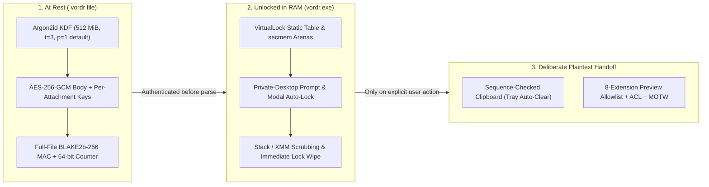
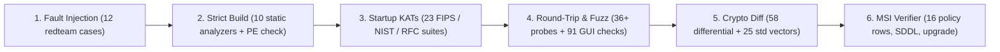

# Why Vordr Earns Trust

[Project overview](../README.md) · [Documentation](README.md) · [Architecture](ARCHITECTURE.md) · [Assurance](ASSURANCE.md) · [File format](formats.md) · [Security policy](../SECURITY.md)

Trust in a password manager cannot rest on promises—it must be earned through an architecture that eliminates entire classes of risk by construction, transparent boundaries, and automated proof anyone can reproduce offline.

---

## 1. Why the architecture was designed this way

Most password managers pull in hundreds of third-party packages, run inside browser engines or managed runtimes, and maintain persistent cloud connections. Each layer adds attack surface that no single person can audit.

Vordr takes the opposite engineering path:

| Architectural decision | Failure classes eliminated by construction | Where enforced |
|---|---|---|
| **Zero-network, offline-only binary** | Remote server breaches, credential-sync interception, silent telemetry, and compromised auto-update channels. Vordr links zero networking APIs (`ws2_32`, `winhttp`, `wininet` are absent). | Import table & [`src/`](ARCHITECTURE.md#source-map) |
| **Zero third-party libraries or runtime** | Transitive dependency supply-chain attacks, garbage-collector copies of plaintext in RAM, and JIT/runtime vulnerabilities. One native x64 executable (~26 assembly modules) links exclusively against Windows `System32` DLLs. | [`loadcfg.asm`](ARCHITECTURE.md#runtime-hardening) (`DependentLoadFlags = 0x0800`), [`pe_normalise.py`](../tools/pe_normalise.py) |
| **Single authenticated container (`.vordr`)** | Unauthenticated metadata tampering, attachment splicing, and undetected cloud-sync rollbacks. Every byte on disk—header, encrypted body, encrypted attachments, and the 64-bit monotonic save counter—is covered by cryptographic authentication before any record is parsed. | [`vault.asm`](formats.md), [`verify_vault.py`](../tests/verify_vault.py) |
| **Byte-for-byte reproducible builds** | Unverifiable release binaries. Two clean builds of the same git tag with the documented MSVC/SDK toolchain produce identical SHA-256 executables with ASLR, DEP/NX, high-entropy VA, and CET shadow-stack flags intact. | [`build.cmd`](RELEASES.md#reproduce-an-executable), [`verify_repro.ps1`](../tools/verify_repro.ps1) |

---

## 2. How secrets are protected across their lifecycle

### Cryptographic & container guarantees
- **Memory-hard key derivation**: Master passwords pass through **Argon2id** (RFC 9106; default `512 MiB` RAM, `3` passes, `1` lane; reader enforces `1..16` passes and `8 KiB..4 GiB` bounds before allocation). A 16-byte SHA-256 key-check value (`KCV`) rejects wrong passwords in constant time (`ct_memcmp`).
- **Authenticated encryption with fresh nonces**: The decrypted record body (`<= 16 MiB`) is sealed with **AES-256-GCM** using the full 80-byte header as associated data (`AAD`) and a fresh 96-bit random nonce (`BCryptGenRandom` supplemented with hardware `RDSEED` across 8-byte lanes and `1..7`-byte tails) on every save.
- **Independent attachment encryption**: Each attached file (`<= 256 MiB`, section `<= 3,840 MiB`, checked with overflow-safe 64-bit arithmetic) receives its own random 256-bit AES-GCM key and 96-bit nonce, bound via 24-byte `AAD` (`id || length`).
- **Mandatory full-file MAC, anti-rollback & archive binding**: A domain-separated **BLAKE2b-256** trailer (`"vordr-file-mac-v1" || vault_key || image || save_counter`) authenticates the entire file before record parsing. The 64-bit save counter is mirrored monotonically under `HKCU\SOFTWARE\Vordr\Rollback` keyed by canonical NTFS handle path (`GetFinalPathNameByHandleW`), flagging older restored files regardless of path casing or junctions. Interoperable AES-256 `.zip` exports also embed per-attachment `SHA-256` plaintext digests inside `vordr.json`, failing closed with atomic rollback if any referenced ZIP member is swapped, corrupted, or omitted (`zexselkat`).
- **Hardware-bound convenience unlock (4 configurable modes)**: `TpmUnlockMode` supports **Off (`0`)**, **TPM only (`1`, default)**, **TPM + PIN (`2`)**, and **TPM + Windows Hello (`3`)** (with an optional `HKLM`-only `TpmMinMode` floor, and automatic migration from legacy `TpmUnlock`/`TpmRequireHello` values). Active modes write versioned `VTPM` v1 envelopes bound to the vault's `68`-byte invariant header (`magic`, `version`, Argon2 cost, `salt`, and `KCV`—excluding the per-save `VH_NONCE` so resealing never invalidates TPM envelopes) and seal secrets under non-exportable decryption-only `>= 2048`-bit RSA keys in the Microsoft Platform Crypto Provider (`"Vordr-TPM-v2" || vault_salt || LE32(req_hello)` inner SHA-256 tag verified in constant time).
  - **`TPM + PIN` anti-replay & strike revocation (`Mode 2`)**: Enforces `PinMinLen` (default `6` scalars, no character-class rule) and optional `PinRejectTrivial` (default `1`, rejecting all-same, `+/-1` arithmetic runs, `2`-/`3`-codepoint cycles, and palindromes `>= 4` chars). On every unlock attempt—**before** testing the candidate PIN—Vordr atomically increments `fails` and `gen`, creates a fresh TPM key in alternate slot `Vordr-<KCV>-S{slot ^ 1}`, commits the re-encrypted `680`-byte outer state envelope to `HKCU`, and deletes old `S{slot}`. Restoring a snapshotted `HKCU` blob fails unseal or GCM authentication immediately and revokes TPM unlock; reaching `TpmPinMaxAttempts` (default `3`, range `1..20`) deletes all TPM keys and forces master-password unlock without tripping OS-wide Windows TBS dictionary-attack lockout. Candidate PINs stretch through `Argon2id` (`64 MiB`, `t=2`, `p=1`) and combine with the machine PCP secret via `BLAKE2b-256` (`tpmkat`).
  - **`TPM + Windows Hello` dual-key binding (`Mode 3`)**: Combines a PCP-sealed `tpm_secret[32]` with a `hello_secret[32]` masked by a Windows Hello platform FIDO2 `PRF` (`hmac-secret`) credential (`webauthn.dll`, pinned to the Windows Hello authenticator AAGUID with `USER_VERIFICATION_REQUIRED`), deriving the AES-256-GCM wrapping key via `BLAKE2b-256(tpm_secret || hello_secret)` and deleting replaced platform credentials on re-enrollment or revocation.
- **Dedicated PIN secret grading & domain-separated health checks**: `VF_PIN` (`20`) fields share full secret-memory, IME-detachment, edit-scrubbing, clipboard-exclusion, phonetic-reveal, and history protections with `VF_SECRET`, while `pin_eval` and `vault_health` evaluate PINs under PIN-specific length and trivial-pattern rules (`pinkat`) and domain-separate `BLAKE2b-128` reuse digests by field kind so `VF_PIN` values never collide with `VF_SECRET` (`healthkat`).

### Process, desktop & OS defense-in-depth
- **Startup self-test, CPU gate & process mitigations**: Every launch verifies AES-NI, PCLMULQDQ, SSE4.1, and SHA-NI (plus `OSXSAVE` + `XCR0` before enabling AVX2), applies `SetProcessMitigationPolicy` (`ExtensionPointDisable`, `StrictHandleCheck`, `ImageLoadPolicy`, `DynamicCodePolicy`), and runs **23 known-answer test suites** fail-closed before creating any window or opening any file.
- **Pinned secret memory, generator entropy & scrubbing**: `sec_regions` (`secmem.asm`) pins static secret buffers with `VirtualLock` at startup (`lktest` verifies physical working-set residency via `QueryWorkingSetEx`), while `secmem_alloc` tracks dynamic plaintext arenas out-of-line (`g_secmem_live`) and wipes on free, lock, and handled fatal exceptions. Passphrase generation draws unbiased indices across a `2,048`-word list (`11` bits/word, `6`-word / `66`-bit minimum). AES key expansion uses hardware `aeskeygenassist` (no RAM S-box tables), Argon2 scrubs `H0` immediately after lane seeding, and all crypto primitives scrub stack frames and volatile `xmm`/`ymm` registers on return.
- **Assembly control-flow, I/O & heap hardening**: Hardware CET shadow-stack compatibility (`/CETCOMPAT`) is paired with a per-thread TLS software shadow stack (`FRAME_PROLOG`/`FRAME_EPILOG` verifying top-of-stack and ancestor integrity), stack canaries, landing-pad indirect-call guards, canary-tagged heap allocations (`tagged_alloc`/`tagged_free`), read-only import tables after startup, and pre-/post-`CreateFileW` reparse-point, device-namespace, ADS, and UNC gates (`file_path_allowed` / `file_validate_handle`).
- **Safe desktop, screen, clipboard & preview boundaries**:
  - **Screen-capture & IME protection**: All Vordr windows enable `SetWindowDisplayAffinity(WDA_EXCLUDEFROMCAPTURE)` by default (`AllowScreenCapture = 0`), and secret `EDIT` controls detach IME (`ImmAssociateContext`) and overwrite internal text/undo buffers before teardown.
  - **Private desktop & verified IPC**: `SecureUnlock` prompts on an isolated Windows desktop (`CreateDesktopW`) protected by an explicit owner+`SYSTEM` DACL (`HKLM` policy refuses normal-desktop fallback; `secdeskkat`). Singleton mutex creation applies an owner+`SYSTEM` DACL plus Medium-IL `NO_WRITE_UP` SACL, and `WM_COPYDATA` verifies both sender and receiver process binaries (`QueryFullProcessImageNameW`).
  - **Modal-safe auto-lock & fail-closed clipboard**: Auto-lock dismisses open Vordr modals (`Cancel`) and immediately wipes `g_vkey` and decrypted buffers (`guitest.ps1`); clipboard copies require exclusion-format markers (`ExcludeClipboardContentFromMonitorProcessing`) to succeed and clear via the persistent tray window (`g_trayhwnd`) using `GetClipboardSequenceNumber`.
  - **Allowlisted attachment previews**: Automatic preview permits only `.txt`, `.png`, `.jpg`, `.jpeg`, `.gif`, `.bmp`, `.webp`, and `.pdf`, sanitized of path/ADS tricks, written inside an inheritable owner+`SYSTEM` ACL'd temp directory (with stale `VordrPreview-*` directories swept at startup), and stamped fail-closed with Mark of the Web (`ZoneId=3`). All other file types route strictly to **Save As**.
  - **Fail-closed enterprise policy**: `HKLM\SOFTWARE\Vordr` locks settings (`*locked = 1`) without falling back to `HKCU` on wrong registry types, enforces `AllowUncVault` exclusively from `HKLM`, and resolves `HKLM` `REG_EXPAND_SZ` vault paths from `HKLM\...\ProfileList\<UserSID>\ProfileImagePath` rather than user-writable `HKCU` environment or shell-folder keys (`polkat`).

---

## 3. How trust is verified (run it yourself)

Every invariant above is continuously enforced by a six-stage offline verification gate (`tests\run_all.cmd`) and independent Python stdlib verifiers that share **zero code** with Vordr:

| Verification layer | What it proves | Command to reproduce |
|---|---|---|
| **Independent vault reader** | A standalone Python reader (with its own RFC 9106 Argon2id and pure-Python AES-256-GCM, written solely from [`docs/formats.md`](formats.md)) decrypts real `.vordr` vaults, rejects byte flips across every file region, and confirms fresh nonces per save. | `python tests\verify_vault.py bin\vordr.exe` |
| **Differential & standard crypto vectors** | Cross-checks 58 primitive outputs against Python `hashlib`/`hmac`/AES-GCM and 25 published FIPS 180-4, FIPS 197, SP 800-38A/D, RFC 2202, RFC 4226, RFC 6238, RFC 7693, and RFC 9106 vectors (including multi-segment 64 MiB Argon2id). | `python tests\verify_crypto.py --exe bin\vordr.exe` |
| **10 static source/ABI/PE analyzers** | Verifies Win64 stack frames and raw OS callbacks (`framecheck`), callee-saved GP/XMM registers and `vzeroupper` (`nvcheck`), control IDs (`idcheck`, `dlgtarget`, `rccheck`), cross-module constants (`constcheck`), string bounds (`wstrcheck`), wide alignment (`aligncheck`), dead symbols (`deadcode`), docs (`check_docs`), and `System32` PE load flags (`pe_normalise`)—all guarded against silent coverage drops by [`floors.py`](../tools/floors.py). | `build.cmd release strict` |
| **Fault injection & crash containment** | Deliberately triggers stack canary, TLS shadow-stack, landing-pad, heap-tag, bounds, overflow, crash-reentrancy, `System32` DLL load, and read-only IAT faults, asserting each exact fail-fast exit code (`0xFADExxxx`). | `python tests\redteam.py bin\vordr.exe` *(on a `dbg` build)* |
| **Isolated GUI & parser fuzzing** | Exercises `vfuzz`, `fuzzzip`, `jfuzz`, `attfuzz`, attachment/overflow/policy/TPM/private-desktop KATs, `v0.2.3` backward compatibility (`compattest.py`), and 91 live Win32 checks in an `HKCU`-isolated process (`guitest.ps1`). | `tests\run_all.cmd` *(in a test checkout/VM)* |
| **Byte-for-byte reproducibility** | Builds `release strict` twice from clean state and verifies identical SHA-256 hashes and PE mitigation flags. | `powershell -NoProfile -ExecutionPolicy Bypass -File tools\verify_repro.ps1` |

---

## 4. Honest boundaries (what no offline user-mode app can claim)

Credible security engineering states its boundaries as clearly as its protections:

- **No external third-party audit recorded**: All verification tools in this repository are open and reproducible, but they do not substitute for an independent external audit or formal proof over all inputs.
- **Master password strength**: Argon2id makes each password guess expensive (`512 MiB` RAM by default), yet a weak or reused master password remains vulnerable to offline guessing if a `.vordr` file is stolen.
- **Compromised OS, administrator, or hardware**: User-mode `VirtualLock`, zeroing, and private-desktop prompts cannot protect an unlocked vault against a malicious kernel driver, same-user/admin debugger, physical DMA/cold-boot attack, or unencrypted OS hibernation (`hiberfil.sys` without BitLocker/full-disk encryption).
- **Deliberate plaintext handoff**: Copying a secret to the clipboard, revealing it on screen, or opening/downloading an attachment places plaintext into Windows or a viewer application whose own memory and disk caches Vordr cannot erase.
- **Local rollback history & TPM scope**: The `HKCU` save-counter mirror catches accidental sync rollbacks on the same PC, not an attacker who restores both the vault and registry (or opens an old copy on a fresh PC). TPM unlock is a local convenience wrapper, never a replacement for keeping your master password backed up.

For deep module internals see [Architecture](ARCHITECTURE.md), [Secret memory](SECRETS.md), and [Assurance](ASSURANCE.md). To report a vulnerability privately, follow [SECURITY.md](../SECURITY.md).
