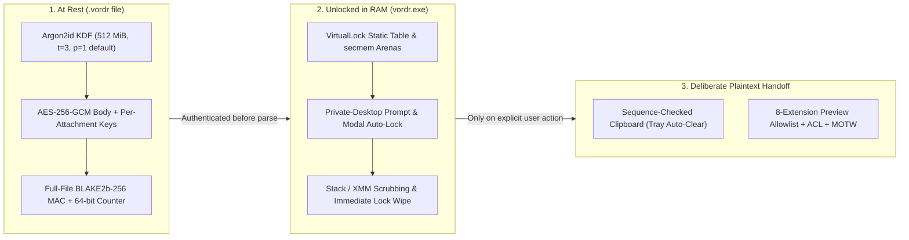
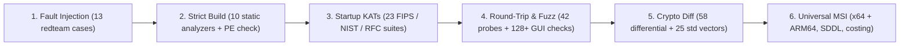

# Why Vordr Earns Trust

[Project overview](../README.md) · [Documentation](README.md) · [Architecture](ARCHITECTURE.md) · [Assurance](ASSURANCE.md) · [File format](formats.md) · [Security policy](../SECURITY.md)

Trust in a password manager cannot rest on promises—it must be earned through an architecture that eliminates entire classes of risk by construction, transparent boundaries, and automated proof anyone can reproduce offline.

---

## 1. Why the architecture was designed this way

Most password managers pull in hundreds of third-party packages, run inside browser engines or managed runtimes, and maintain persistent cloud connections. Each layer adds attack surface that no single person can audit.

Vordr takes the opposite engineering path:

| Architectural decision | Failure classes eliminated by construction | Where enforced |
|---|---|---|
| **Zero-network, offline-only binary** | Remote server breaches, credential-sync interception, silent telemetry, and compromised auto-update channels. Both x64 and ARM64 binaries link zero networking APIs (`ws2_32`, `winhttp`, `wininet` are absent). | Import table & [`src/`](ARCHITECTURE.md#source-map) |
| **Zero third-party libraries or runtime** | Transitive dependency supply-chain attacks, garbage-collector copies of plaintext in RAM, and JIT/runtime vulnerabilities. Native x64 (`vordr.exe`, 27 MASM modules) and native ARM64 (`vordr-arm64.exe`, 24 translated + 5 hand-written AArch64 ISA modules) binaries link exclusively against 15 Windows `System32` DLLs and load only 4 optional `System32` DLLs (`d3d11`, `wer`, `webauthn`, `tbs`) with `LOAD_LIBRARY_SEARCH_SYSTEM32`. | [`loadcfg.asm`](ARCHITECTURE.md#runtime-hardening) (`DependentLoadFlags = 0x0800`), [`ARM64.md`](ARM64.md), [`pe_normalise.py`](../tools/pe_normalise.py) |
| **Single authenticated container (`.vordr`)** | Unauthenticated metadata tampering, attachment splicing, and undetected cloud-sync rollbacks. Every byte on disk—header, encrypted body, encrypted attachments, and the 64-bit monotonic save counter—is covered by cryptographic authentication before any record is parsed. | [`vault.asm`](formats.md), [`verify_vault.py`](../tests/verify_vault.py) |
| **Byte-for-byte reproducible builds** | Unverifiable release binaries. Two clean builds of both `vordr.exe` and `vordr-arm64.exe` from the same git tag with the documented MSVC/SDK/LLVM toolchains produce identical SHA-256 hashes with ASLR, DEP/NX, high-entropy VA, `_ROINIT` isolation, and x64 CET shadow-stack flags intact. | [`build.cmd`](RELEASES.md#reproduce-an-executable), [`build_arm64.cmd`](ARM64.md#building-and-verification), [`verify_repro.ps1`](../tools/verify_repro.ps1) |

---

## 2. How secrets are protected across their lifecycle

### Cryptographic & container guarantees
- **Memory-hard key derivation**: Master passwords pass through **Argon2id** (RFC 9106; default `512 MiB` RAM, `3` passes, `1` lane; reader enforces `1..16` passes and `8 KiB..4 GiB` bounds before allocation). A 16-byte SHA-256 key-check value (`KCV`) rejects wrong passwords in constant time (`ct_memcmp`).
- **Authenticated encryption with fresh nonces**: The decrypted record body (`<= 16 MiB`) is sealed with **AES-256-GCM** using the full 80-byte header as associated data (`AAD`) and a fresh 96-bit random nonce (`BCryptGenRandom` supplemented with hardware `RDSEED` on x64 or ARMv8.5 `RNDRRS` on ARM64 when all online cores advertise `FEAT_RNG`) on every save.
- **Independent attachment encryption**: Each attached file (`<= 256 MiB`, section `<= 3,840 MiB`, checked with overflow-safe 64-bit arithmetic) receives its own random 256-bit AES-GCM key and 96-bit nonce, bound via 24-byte `AAD` (`id || length`).
- **Mandatory full-file MAC, anti-rollback & archive binding**: A domain-separated **BLAKE2b-256** trailer (`"vordr-file-mac-v1" || vault_key || image || save_counter`) authenticates the entire file before record parsing. The 64-bit save counter is mirrored monotonically under `HKCU\SOFTWARE\Vordr\Rollback` keyed by the SHA-256 hash of the canonical upper-cased NTFS handle path (`GetFinalPathNameByHandleW`), flagging older restored files regardless of path casing or junctions. Interoperable AES-256 `.zip` exports also embed per-attachment `SHA-256` plaintext digests inside `vordr.json`, failing closed with atomic rollback if any referenced ZIP member is swapped, corrupted, or omitted (`zexselkat`).
- **Hardware-bound convenience unlock (4 configurable modes)**: `TpmUnlockMode` supports **Off (`0`)**, **TPM only (`1`, default)**, **TPM + PIN (`2`)**, and **TPM + Windows Hello (`3`)** (with an optional `HKLM`-only `TpmMinMode` floor, fail-closed clamping on corrupt `HKLM` values, and automatic migration from legacy `TpmUnlock`/`TpmRequireHello`). Active modes write versioned `VTPM` v1 envelopes bound to the vault's `68`-byte invariant header (`magic`, `version`, Argon2 cost, `salt`, and `KCV`—excluding the per-save `VH_NONCE` so resealing never invalidates TPM envelopes), enforce `blob_mode >= g_tpm_want`, and seal secrets under non-exportable decryption-only `>= 2048`-bit RSA keys in the Microsoft Platform Crypto Provider (`"Vordr-TPM-v2" || vault_salt || LE32(req_hello)` inner SHA-256 tag verified in constant time). Orphan PCP keys are rolled back if `vault_tpm_remember` fails to persist the blob.
  - **`TPM + PIN` anti-replay & strike revocation (`Mode 2`)**: Enforces `PinMinLen` (default `6` scalars, no character-class rule) and optional `PinRejectTrivial` (default `1`, rejecting all-same, `+/-1` arithmetic runs, `2`-/`3`-codepoint cycles, and palindromes `>= 4` chars). On every unlock attempt—**before** testing the candidate PIN—Vordr atomically increments `fails` and `gen`, creates a fresh TPM key in alternate slot `Vordr-<KCV>-S{slot ^ 1}`, commits the re-encrypted `680`-byte outer state envelope to `HKCU`, and deletes old `S{slot}` (aborting unlock fail-closed if `NCryptDeleteKey` fails). Restoring a snapshotted `HKCU` blob fails unseal or GCM authentication immediately and revokes TPM unlock; reaching `TpmPinMaxAttempts` (default `3`, range `1..20`) deletes all TPM keys and forces master-password unlock without tripping OS-wide Windows TBS dictionary-attack lockout. Candidate PINs stretch through `Argon2id` (`64 MiB`, `t=2`, `p=1`) and combine with the machine PCP secret via `BLAKE2b-256` (`tpmkat`).
  - **`TPM + Windows Hello` dual-key binding (`Mode 3`)**: Runs Windows Hello unsealing **before** TPM unsealing, combining a PCP-sealed `tpm_secret[32]` with a `hello_secret[32]` masked by a Windows Hello platform FIDO2 `PRF` (`hmac-secret`) credential (`webauthn.dll`, pinned to the Windows Hello authenticator AAGUID with `USER_VERIFICATION_REQUIRED`, validating `UP|UV` flags and credential ID on both seal and unseal, scrubbing `pbFirst`, and deleting replaced or orphaned platform credentials via `WebAuthNDeletePlatformCredential`), deriving the AES-256-GCM wrapping key via `BLAKE2b-256(tpm_secret || hello_secret)`.
- **Dedicated PIN secret grading & domain-separated health checks**: `VF_PIN` (`20`) fields share full secret-memory, IME-detachment, edit-scrubbing, clipboard-exclusion, phonetic-reveal, and history protections with `VF_SECRET`, while `pin_eval` and `vault_health` evaluate PINs under PIN-specific length and trivial-pattern rules (`pinkat`) and domain-separate `BLAKE2b-128` reuse digests by field kind so `VF_PIN` values never collide with `VF_SECRET` (`healthkat`).

### Process, desktop & OS defense-in-depth
- **Startup self-test, CPU gate & process mitigations**: Every launch verifies required ISA crypto extensions (x64: AES-NI, PCLMULQDQ, SSE4.1, SHA-NI, plus `OSXSAVE`+`XCR0` for optional AVX2; ARM64: ARMv8 Crypto Extensions `AESE`/`AESMC`/`PMULL`/`SHA256*`/`SHA1*`, plus per-core `FEAT_RNG` enumeration for optional `RNDRRS`), enforces `HeapEnableTerminationOnCorruption`, `SetDefaultDllDirectories(LOAD_LIBRARY_SEARCH_SYSTEM32)`, `SetProcessMitigationPolicy` (`ProcessExtensionPointDisablePolicy` and `ProcessImageLoadPolicy` with `NoRemoteImages | NoLowMandatoryLabelImages | PreferSystem32Images`), and `WerSetFlags(0x1E1)` + `WerAddExcludedApplication`, then runs **23 known-answer test suites** fail-closed before creating any window or opening any file.
- **Pinned secret memory, generator entropy & scrubbing**: `sec_regions` (stored in `.const` in `secmem.asm`) pins **85** static secret buffers with `VirtualLock` at startup (`lktest` verifies physical working-set residency via `QueryWorkingSetEx`). Dynamic `secmem_alloc` arenas carry a trailing 4 KiB `PAGE_NOACCESS` guard page, fail closed if `VirtualLock` fails, serialize their out-of-line 1024-slot registry (`g_secreg`) via an `SRWLOCK`, and wipe on free, lock, and handled fatal exceptions—alongside the pinned off-screen window compositor DIB (`g_comp_bits`) and temporary foreign-import bodies (`g_foreign_body`). Passphrase generation draws unbiased indices across a `2,048`-word list (`11` bits/word, `6`-word / `66`-bit minimum). AES key expansion uses hardware instructions (no RAM S-box tables), Argon2 scrubs `H0` immediately after lane seeding, and all x64/ARM64 crypto primitives scrub stack frames and volatile vector registers (`xmm`/`ymm` or `v0..v31`) on return.
- **Assembly control-flow, write-once `_ROINIT`, I/O & heap hardening**: Hardware CET shadow-stack compatibility (`/CETCOMPAT` on x64) or pointer authentication (`PACIBSP`/`AUTIBSP` on ARM64) pairs with a guard-paged per-thread TLS software shadow stack (`4,096` entries per thread, `FRAME_PROLOG`/`FRAME_EPILOG` verifying top-of-stack and ancestor integrity), stack canaries, landing-pad indirect-call guards, guard-paged canary-tagged heap allocations (`tagged_alloc`/`tagged_free`), XOR-encoded dynamic function pointers (`g_ptr_cookie`), and post-startup `PAGE_READONLY` lockdown of both the PE IAT and the 4 KiB-isolated `_ROINIT` section (`g_stack_canary`, `g_ptr_cookie`, `g_sstk_tls`, `g_cpu_features`, `g_img_lo`, `g_img_hi`). File I/O enforces pre-/post-`CreateFileW` reparse-point, device-namespace, `..` traversal, `\\?\`, ADS, and UNC gates (`file_path_allowed` / `file_validate_handle`) with inside-retry reparse checks on rename and backup rotation.
- **Safe desktop, screen, IPC, clipboard & preview boundaries**:
  - **Screen-capture & IME protection**: All Vordr windows enable `SetWindowDisplayAffinity(WDA_EXCLUDEFROMCAPTURE)` by default (`AllowScreenCapture = 0`, `HKLM`-only in production), and secret `EDIT` controls detach IME (`ImmAssociateContext`), route `WM_COPY`/`WM_CUT` through `gui_copy`, and overwrite internal text/undo buffers before teardown.
  - **Private desktop & kernel-authenticated named-pipe IPC**: `SecureUnlock` passes an explicit protected owner+`SYSTEM` DACL (omitting `DESKTOP_HOOKCONTROL` and `WRITE_DAC`) atomically to `CreateDesktopW`, isolates per-invocation state (`g_sd_slots`) under a 3-state atomic CAS (`0` running / `1` worker done / `2` orphaned) with 200 ms orphan cancellation polling, full secret scrubbing on timeout, and consumer `lfence` (ARM64 `dmb ish`) acquire barriers (`HKLM` policy refuses normal-desktop fallback; `secdeskkat`). Legacy `WM_COPYDATA` is unconditionally rejected; second-instance hand-off uses a per-SID duplex named pipe (`\\.\pipe\VordrIPC-<16hex>`, `PIPE_REJECT_REMOTE_CLIENTS`, protected owner+`SYSTEM` DACL + Medium-IL `NO_WRITE_UP` SACL) with mutual `GetNamedPipeClientProcessId`/`GetNamedPipeServerProcessId` + file-identity verification, bounded 250 ms overlapped I/O, and a 1-byte server liveness ACK/NACK closing PID-reuse races.
  - **Modal-safe auto-lock & fail-closed clipboard**: Auto-lock dismisses open Vordr modals (`Cancel`), discards unsaved Settings edits rather than auto-committing them, and immediately wipes `g_vkey`, `g_comp_bits`, and decrypted buffers (`guitest.ps1`); clipboard copies require exclusion-format markers (`ExcludeClipboardContentFromMonitorProcessing`) to succeed and clear via the persistent tray window (`g_trayhwnd`) using `GetClipboardSequenceNumber`.
  - **Allowlisted, handle-verified attachment previews**: Automatic preview permits only `.txt`, `.png`, `.jpg`, `.jpeg`, `.gif`, `.bmp`, `.webp`, and `.pdf`, sanitized of path/ADS tricks, written inside an inheritable owner+`SYSTEM` ACL'd temp directory, and stamped fail-closed with Mark of the Web (`ZoneId=3`). Startup stale-directory cleanup (`gui_temp_sweep_stale`) opens candidates exclusively with `FILE_FLAG_OPEN_REPARSE_POINT`, rejects directories, reparse points, and NTFS hardlinks (`nNumberOfLinks > 1`), validates the canonical `%TEMP%\VordrPreview-\` handle prefix, and clears read-only attributes and deletes strictly by handle (`SetFileInformationByHandle`). All other file types route exclusively to **Save As**.
  - **Fail-closed enterprise policy**: `HKLM\SOFTWARE\Vordr` locks settings (`*locked = 1`) without falling back to `HKCU` on wrong registry types, enforces `AllowUncVault`, `AllowScreenCapture`, and `TpmMinMode` exclusively from `HKLM`, and resolves `HKLM` `REG_EXPAND_SZ` vault paths via `GetUserProfileDirectoryW` (`HKLM\...\ProfileList\<UserSID>\ProfileImagePath`) rather than user-writable `HKCU` environment or shell-folder keys (`polkat`).

---

## 3. How trust is verified (run it yourself)

Every invariant above is continuously enforced by a six-stage offline verification gate (`tests\run_all.cmd`), four ARM64 Unicorn emulation suites (`tests\arm64\test_*.py`), and independent Python stdlib verifiers that share **zero code** with Vordr:

| Verification layer | What it proves | Command to reproduce |
|---|---|---|
| **Independent vault reader** | A standalone Python reader (with its own RFC 9106 Argon2id and pure-Python AES-256-GCM, written solely from [`docs/formats.md`](formats.md)) decrypts real `.vordr` vaults, rejects byte flips across every file region, and confirms fresh nonces per save. | `python tests\verify_vault.py bin\vordr.exe` |
| **Differential & standard crypto vectors** | Cross-checks 58 primitive outputs against Python `hashlib`/`hmac`/AES-GCM and 25 published FIPS 180-4, FIPS 197, SP 800-38A/D, RFC 2202, RFC 4226, RFC 6238, RFC 7693, and RFC 9106 vectors (including multi-segment 64 MiB Argon2id). | `python tests\verify_crypto.py --exe bin\vordr.exe` |
| **10 static source/ABI/PE analyzers** | Verifies Win64 stack frames and raw OS callbacks (`framecheck`), callee-saved GP/XMM registers and `vzeroupper` (`nvcheck`), control IDs (`idcheck`, `dlgtarget`, `rccheck`), cross-module constants (`constcheck`), string bounds (`wstrcheck`), wide alignment (`aligncheck`), dead symbols (`deadcode`), docs (`check_docs`), and `System32`/`_ROINIT`/W^X/CET PE checks (`pe_normalise`)—all guarded against silent coverage drops by [`floors.py`](../tools/floors.py). | `build.cmd release strict` |
| **Fault injection & crash containment** | Deliberately triggers stack canary, TLS shadow-stack (top and ancestor-skip), landing-pad, guard-paged heap-tag, bounds, overflow, crash-reentrancy, `System32` DLL load (`dllhijack`), and read-only IAT faults across 13 cases (19 assertions), verifying each exact fail-fast exit code (`0xFADExxxx`) or `0xC0000409` containment. | `python tests\redteam.py bin\vordr.exe` *(on a `dbg` build)* |
| **Isolated GUI, GPU & parser fuzzing** | Exercises 42 probes (`vfuzz` 100k, `fuzzzip` 100k, `jfuzz` 20k, `attfuzz` 4k, attachment/overflow/policy/TPM/GPU/private-desktop KATs, `layoutkat`), `v0.2.3` backward compatibility (`compattest.py`), persistence harnesses, and 128+ (up to 152) live Win32 checks in an `HKCU`-isolated process (`guitest.ps1`). | `tests\run_all.cmd` *(in a test checkout/VM)* |
| **ARM64 crypto & 8-stage E2E emulation** | Executes `src/arm64/*.S` and the linked `bin\vordr-arm64.exe` under Unicorn ARM64 emulation: FIPS/NIST/RFC crypto KATs, constant-time SHA traces, release `selftest` with `FEAT_RNG=0/1`, fail-closed `cpu_gate`, x64-identical 60-line `katreport`, 22 probeio KATs/fuzzers, and cross-arch `.vordr` vault interoperability. | `python tests\arm64\test_arm64_e2e.py` *(plus `test_sha.py`, `test_blake2b_argon2.py`, `test_aesgcm.py`)* |
| **Dual-arch reproducibility & universal MSI** | Builds both `vordr.exe` (x64) and `vordr-arm64.exe` (ARM64) twice from clean state verifying identical SHA-256 hashes and PE mitigations, and validates the universal MSI's 5-column `MsiLockPermissionsEx` SQL, 16 policy rows, live `LaunchConditions`, and x64/ARM64 costing. | `powershell -NoProfile -ExecutionPolicy Bypass -File tools\verify_repro.ps1` |

### Can the encryption implementation itself be trusted?

The most common—and fair—critique of any custom cryptographic implementation that has not undergone a professional, end-to-end external audit is that standard algorithms can still fail through subtle coding mistakes rather than weak math. In Vordr, the **core primitives and container format** have strong empirical verification: `AES-256-GCM`, `Argon2id`, `BLAKE2b`, `SHA-256`, `HMAC-SHA1`, and `TOTP` are cross-checked against 25 published FIPS/RFC/NIST vectors, 58 independent Python differential cases (`verify_crypto.py`), over one million emulated ARM64 primitive/ABI checks, and 23 fail-closed startup self-tests; hardware instructions (`AES-NI`/`PCLMULQDQ` and ARMv8 Crypto Extensions) eliminate RAM S-box cache-timing tables; and an independent Python vault reader (`verify_vault.py`, sharing zero code with Vordr) proves end-to-end decryption, region-by-region tamper rejection, and per-save nonce freshness on real `.vordr` files. Where theoretical room for implementation error remains is in **everything finite testing cannot exhaustively prove**: unexercised edge cases in surrounding protocol glue and error-recovery paths (such as rare import/merge, reload, attachment-rekeying, or TPM/Hello state-rotation branches), a subtle state-machine defect that could skip a memory wipe or mishandle a key/nonce boundary under an unexpected OS failure, microarchitectural or higher-level side channels outside the checked hardware crypto loops, and translation or real-silicon edge cases in the ARM64 translator (`tools/a64/xlat.py`) that emulation does not fully cover. Automated differential tests, fuzzers, and multi-pass internal reviews narrow that gap substantially and let any reader inspect or reproduce every check, yet they are evidence of engineering discipline rather than formal proof or a substitute for an independent cryptographic audit.

---

## 4. Honest boundaries (what no offline user-mode app can claim)

Credible security engineering states its boundaries as clearly as its protections:

- **No external third-party audit recorded**: All verification tools in this repository are open and reproducible, but they do not substitute for an independent external audit or formal proof over all inputs.
- **Master password strength**: Argon2id makes each password guess expensive (`512 MiB` RAM by default), yet a weak or reused master password remains vulnerable to offline guessing if a `.vordr` file is stolen.
- **Compromised OS, administrator, or hardware**: User-mode `VirtualLock`, zeroing, and private-desktop prompts cannot protect an unlocked vault against a malicious kernel driver, same-user/admin debugger, physical DMA/cold-boot attack, or unencrypted OS hibernation (`hiberfil.sys` without BitLocker/full-disk encryption).
- **Deliberate plaintext handoff**: Copying a secret to the clipboard, revealing it on screen, or opening/downloading an attachment places plaintext into Windows or a viewer application whose own memory and disk caches Vordr cannot erase.
- **Local rollback history & TPM scope**: The `HKCU` save-counter mirror catches accidental sync rollbacks on the same PC, not an attacker who restores both the vault and registry (or opens an old copy on a fresh PC). TPM unlock is a local convenience wrapper, never a replacement for keeping your master password backed up.

For deep module internals see [Architecture](ARCHITECTURE.md), [Secret memory](SECRETS.md), and [Assurance](ASSURANCE.md). To report a vulnerability privately, follow [SECURITY.md](../SECURITY.md).
